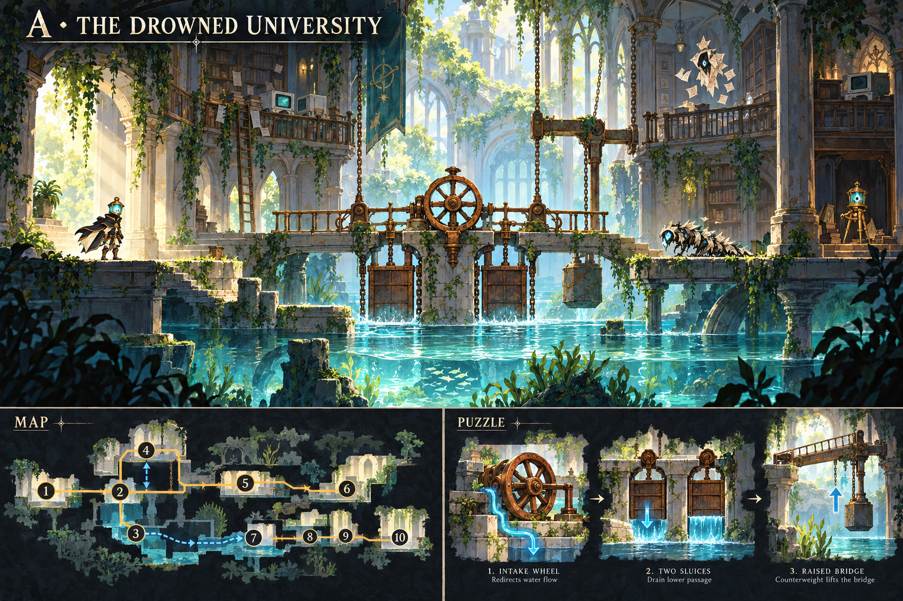
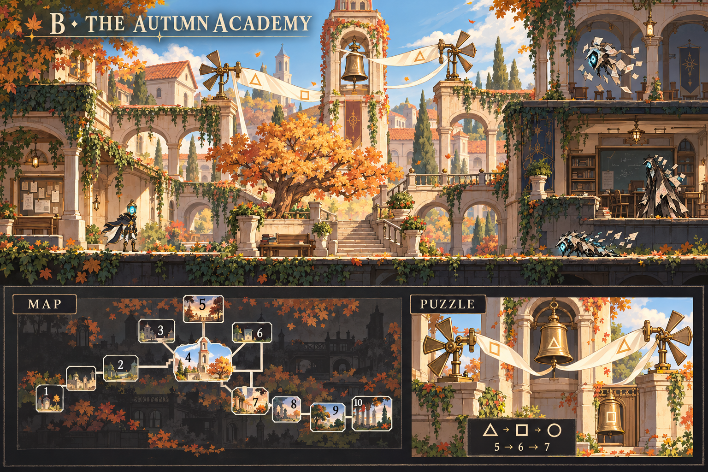
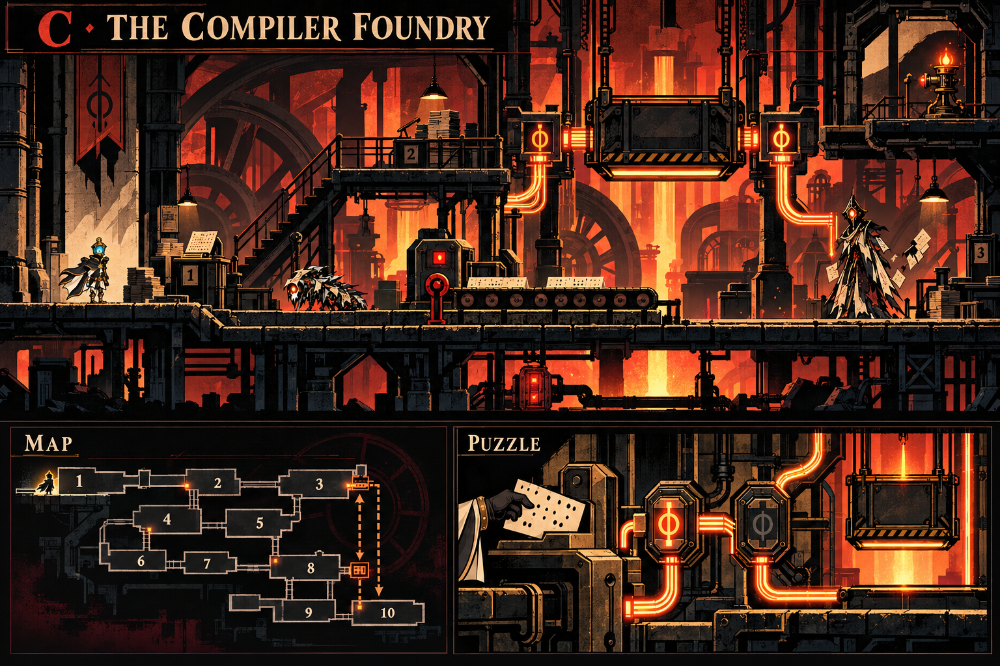
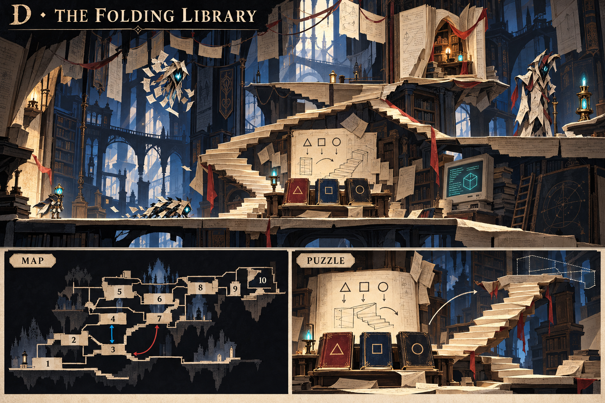
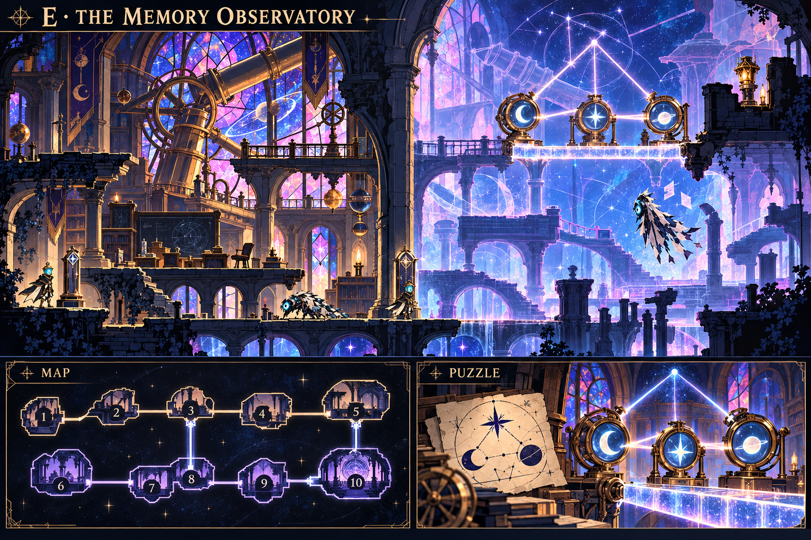

# خمس أفكار للمرحلة الأولى — LAST LECTURE

- [A — الجامعة الغارقة](A_drowned_university.png)
- [B — أكاديمية الخريف](B_autumn_academy.png)
- [C — مصنع المترجم](C_compiler_foundry.png)
- [D — المكتبة المتحولة](D_folding_library.png)
- [E — مرصد الذاكرة](E_memory_observatory.png)

**[تحميل الصور الخمس كاملة في ملف ZIP](https://github.com/thamrhntwl538-cell/-2d/archive/refs/heads/stage1-concepts.zip)**

اضغط اسم الفكرة لفتح صورتها، أو حمّل الملف المضغوط وفك الضغط لعرض ملفات PNG على جهازك. هذه لوحات تصورية للمقارنة؛ الخرائط المصغرة داخلها تخطيطية، وتُحدَّد وصلات الغرف وشروط فتحها بعد اختيار الفكرة.

## A — الجامعة الغارقة

مسار علوي جاف وآخر سفلي يُكشف بتصريف الماء، مع لغز عجلة تدفق وبوابات مائية ترفع جسرًا.

## B — أكاديمية الخريف

ساحة مركزية تتفرع منها المناطق، مع لغز أجراس ودوارات هواء تُفعَّل بحسب رموز مرئية.

## C — مصنع المترجم

نزول بين طبقات صناعية مع مصعد للعودة، يفتحه لغز بطاقة مثقبة وتوجيه الطاقة بين الوصلات.

## D — المكتبة المتحولة

مسار رأسي بين رفوف وصفحات مطوية، تتحول فيه مطابقة رموز الكتب إلى درج واختصار جديد.

## E — مرصد الذاكرة

مساران متوازيان للحاضر والذاكرة تربطهما نقاط ثابتة، مع لغز كوكبة وعدسات يُنشئ جسرًا ضوئيًا.

