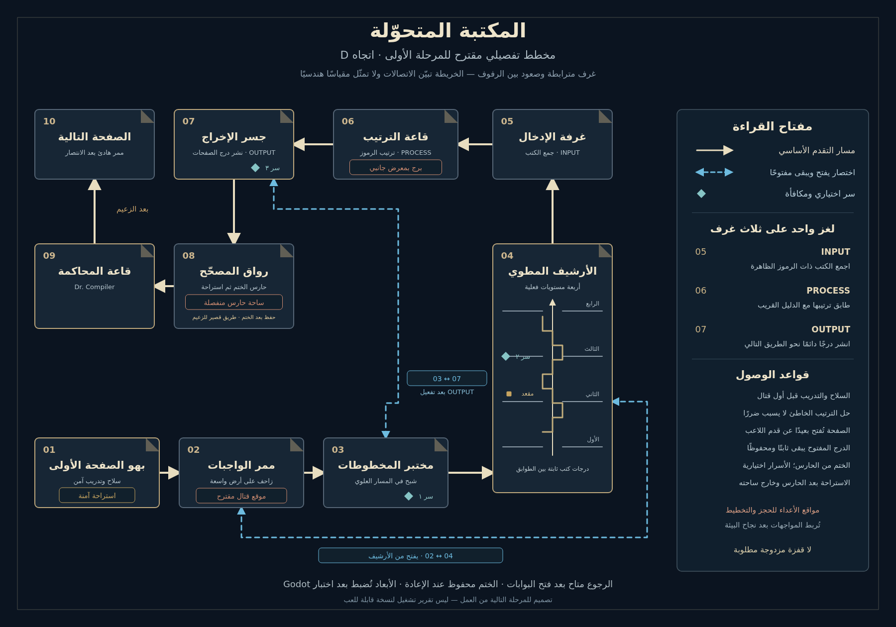

# LAST LECTURE — D: المكتبة المتحوّلة

الاتجاه المختار للمرحلة الأولى: مكتبة تتشكل عمارتها من الكتب والصفحات المطوية، بأوراق عاجية، وعمق كحلي، وشرائط حمراء، وطرفيات جامعية سماوية.

**[افتح الخريطة التفصيلية بالحجم الكامل](D_LIBRARY_MAP.png)** · **[افتح الصورة الفنية الأصلية للخيار D](D_folding_library.png)**

## ماذا تحتوي الخريطة؟

عشر غرف متصلة بالترتيب، من مدخل آمن إلى قاعة د. كومبايلر ثم ممر النهاية. يحافظ المخطط على هوية جناح البرمجة: الواجبات والمختبر والأرشيف والطرفيات.

| الغرفة | الفكرة الأساسية |
|---|---|
| 01 — بهو الصفحة الأولى | كتاب ضخم عند المدخل، سلاح وتدريب آمن، أول استراحة |
| 02 — ممر الواجبات | مسار واضح ومستوي؛ موضع مستقبلي ليرقة الخلل |
| 03 — مختبر المخطوطات | شرفة اختيارية وسر، وعودة من اختصار OUTPUT |
| 04 — الأرشيف المطوي | صعود فعلي عبر أربعة طوابق ودرجات كتب ثابتة؛ استراحة في الثاني وسر في الثالث |
| 05 — غرفة الإدخال | جمع الكتب الثلاثة الظاهرة △ □ ○ |
| 06 — قاعة الترتيب | ترتيب الكتب معًا على طاولة واحدة وفق دليل مصور قريب |
| 07 — جسر الإخراج | نشر صفحة تصير درجًا دائمًا، ثم فتح طريق التقدم واختصار العودة |
| 08 — رواق المصحّح | ساحة حارس الختم؛ استراحة محمية بعد الحارس والختم |
| 09 — قاعة المحاكمة | ساحة د. كومبايلر؛ أرض رئيسية ثابتة وواضحة |
| 10 — الصفحة التالية | هدوء بعد الانتصار وتمهيد للمنطقة التالية |

لغز **INPUT → PROCESS → OUTPUT** منظومة واحدة: جمع الكتب كلها، ثم ترتيبها كلها، ثم نشر الدرج. الخطأ لا يسبب ضررًا ولا يفقد الكتب. تُفتح الصفحة واللاعب على أرض ثابتة خارج حركتها، ثم تبقى مفتوحة ويُحفظ وضعها.

- اختصاران دائمان للعودة: **04↔02** يُفتح من الأرشيف، و**07↔03** بعد اكتمال OUTPUT.
- ثلاث استراحات في **01 و04 و08**، وثلاثة أسرار اختيارية في **03 و04 و07**.
- الأداة تسبق أول مواجهة إلزامية؛ الختم يأتي من الحارس، ومحاولة الزعيم التالية لا تعيد الحارس أو اللغز.
- المقاسات مبنية مبدئيًا على جري البطل وقفزته العادية، دون طلب قفزة مزدوجة أو تسلق جدار.

## ملفات الحزمة

- [LAYOUT_AR.md](LAYOUT_AR.md): توزيع الغرف والمقاسات والحركة والألغاز والحفظ.
- [ART_DIRECTION_AR.md](ART_DIRECTION_AR.md): هوية الرسم والإضاءة والمواد والتكوينات المطلوبة.
- [design.json](design.json): بيانات الغرف والمنصات والبوابات وحالات التقدم المقترحة.
- [D_LIBRARY_MAP.svg](D_LIBRARY_MAP.svg): نسخة متجهة قابلة للتكبير من الخريطة.
- [REVIEW_NOTES.md](REVIEW_NOTES.md): مراجعة الاتساق وما يحتاج اختبارًا عند التنفيذ.

هذه **حزمة تصميم**؛ لا تحتوي نسخة Godot جديدة. الخريطة التخطيطية مستقلة عن مقاسات الغرف بالبكسل، والصورة الفنية الأصلية مرجع بصري وليست خريطة وصلات دقيقة. مواقع الأعداء حجوزات للمستقبل؛ الأولوية لتنفيذ البيئة وصقلها، مع الحفاظ على البطل وألوانه ونسبه وحركته المعتمدة. المقاسات والقفزات تحتاج اختبارًا في Godot عند تنفيذها.

[تنزيل حزمة التصميم ZIP](https://github.com/thamrhntwl538-cell/-2d/archive/refs/heads/stage1-library-design.zip)

للتجربة الحالية: [تنزيل مشروع M16 القابل للفتح في Godot](https://github.com/thamrhntwl538-cell/-2d/archive/refs/tags/m16.zip). فك الضغط وافتح `project.godot` داخل مجلد المشروع. بيئة D المقترحة هنا لم تُنفذ فيه بعد.
