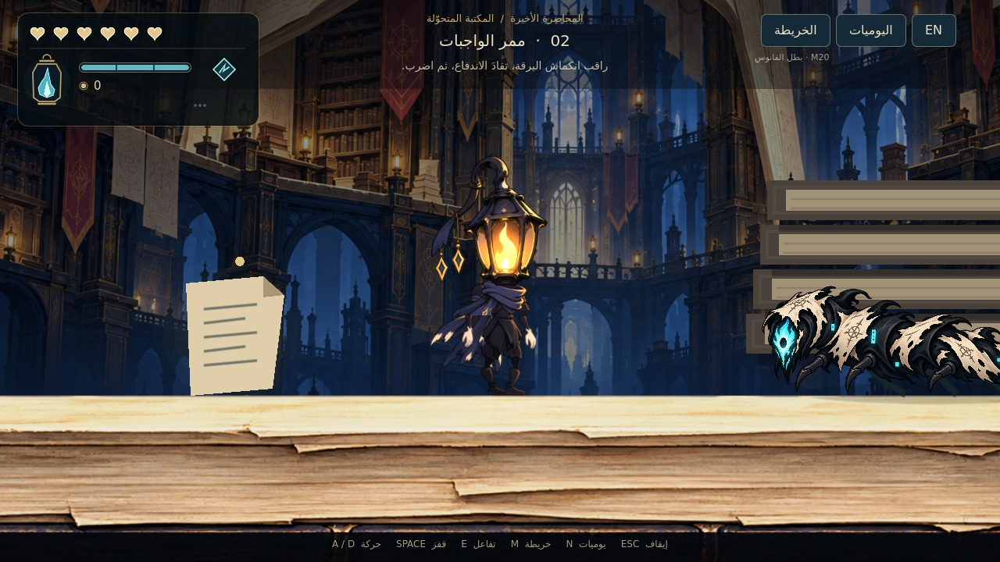

# LAST LECTURE — M20: صقل بطل الفانوس والحركة

صقل البطل داخل **Godot 4.7.2 Standard**: رسم أنظف بحدود ناعمة وظلال أهدأ، مع الحفاظ على الفانوس والشعلة الكهرمانية والعباءة المعتمدة. يوضح التعديل اليد الثانية ويضيف وضعيات الوقوف والنظر لأعلى ولأسفل والتنبّه، ويعيد ضبط الاستجابة والقفز والداش وأثر السيف وفق مرجع الفيديو. تستخدم جميع الحركات أطلس أجزاء واحدًا، بارتفاع يقارب 104 بكسلات من القدم إلى الخطاف.

**[تحميل المشروع كاملًا — M20 ZIP](https://github.com/thamrhntwl538-cell/-2d/archive/refs/heads/m20-hero-polish.zip)** · **[البطل ومعاينته](docs/M20_HERO_AR.md)** · **[اختبار Godot](docs/M20_QA.md)** · **[مواصفات القتال المعتمدة](docs/M18_COMBAT_SPEC_AR.md)**

**[فيديو الحركة والضرب من Godot](previews/m20/15_motion_demo.mp4)** · [التعبيرات الأربع](previews/m20/11_hero_review.jpg) · [أقواس السيف](previews/m20/13_hero_slashes.jpg)

## التشغيل

1. نزّل ZIP وفك الضغط، واحتفظ بالمجلد كاملًا.
2. افتح **Godot4.7.2 Standard** واختر **Import** ثم ملف **`project.godot`** الموجود في جذر المجلد الناتج.
3. انتظر استيراد الرسوم، ثم اضغط **F5**. البداية مضبوطة على `scenes/stage_01/folding_library_m20.tscn`.

لمعاينة البطل وحده مكبّرًا، افتح **`scenes/warden_m20_review.tscn`** واضغط **F6**؛ بدّل صفحات التعبيرات والحركة والضربات بـTab أو1/2/3، واختر الوضعية بالسهمين وأوقف الحركة بـSpace. هذه ساحة لفحص الرسم، بينما تختبر الحركة والقتال الفعليين في اللعبة بـF5. صور المراجعة المقرّبة تستخدم تكبير الكاميرا ولا تغيّر مقاس البطل داخل اللعبة.

يحافظ هذا الإصدار على بيئة المكتبة ذات 15 منطقة وعلى مواجهة يرقة الخلل وأنظمة الطاقة والفتائل من M18، ويقرأ حفظ M18 وM19 نفسه. إعادة تصميم البيئة تأتي بعد اعتماد البطل.

| الفعل | الكيبورد | يد التحكم |
|---|---|---|
| الحركة واتجاه الضربة | A/D وW/S أو الأسهم | العصا اليسرى أوD-pad |
| قفز | Space | A |
| ضرب | J | X |
| داش | K | RB |
| شق الحبر | L | B |
| العلاج مع الثبات | الضغط المطول علىH | الضغط المطول علىY |
| التفاعل | E | LB |
| خريطة | M | Back |
| يوميات | N أوTab | L3 |
| إيقاف | Esc | Start |
| العربية والإنجليزية | F2 | من قائمة الواجهة |

يمكن تغيير ربط الأزرار من **الإيقاف ← التحكم**؛ يحفظ ربط الكيبورد ويد التحكم كلًا على حدة. المسمياتA/B/X/Yتصف توزيع يدXbox، وتختلف الكتابة المطبوعة على أيدي أخرى.

## تجربة المواجهة الأولى

في المنطقة01 اجمع فتيل الاستمداد قرب المقعد، ثم أداة الحارس، ثم قدرة الداش قبل الدرج. جهّز الفتيل عند المقعد إذا أردت زيادة الوهج المكتسب؛ ليس الجمع وحده تجهيزًا. اعبر إلى02 وواجه **يرقة الخلل**: راقب انكماشها، تفاد الاندفاع الثابت، ثم اضرب أثناء التعافي. لا تحتاج إلى الصد أو الداش لهزيمتها.

تحتاج اليرقة إلى ثلاث إصابات سيف أساسية. جسمها اللين آمن، وفكها أثناء الاندفاع مؤذٍ؛ تلاقي السيف مع الجزء الهجومي المناسب يحدث صدًا دون زر منفصل. الانتصار الحقيقي يفتح الطريق إلى03 ويظهر غرض **شق الحبر** قرب أول درج في02. يمكن جمع فتيل المدى على الشرفة العليا في02، وتوسعة السعة في03، وفتيل السكينة قرب استراحة الأرشيف06.

الضربة السفلية الناجحة ترتد بالبطل وتعيد الداش الجوي. توجد حلقات نحاسية واضحة في المناطق الأولى تسمح بتجربة الارتداد البيئي دون منح طاقة مجانية.

## الطاقة والفتائل والموت

- ستة قلوب ومخزون مشترك99؛ إصابة السيف تمنح11أساسيًا، والعلاج أو التقنية يستهلكان33. لا تجدد تلقائيًا، والقدرة لا تشحن نفسها.
- العلاج يحتاج إلى ثبات1.141ثانية تقريبًا؛ يكلف33عند بدء المحاولة، والإصابة أو إلغاء العلاج لا يعيدان المبلغ. يمكن تعديل سرعة العلاج بفتيل السكينة.
- الفتائل الثلاثة: **الاستمداد** يزيد المكسب من11إلى13، **المدى** يمد السيف15%، و**السكينة** يقلل زمن العلاج20%. السعة المبدئية3وتوجد توسعة واحدة إلى4في هذا الإصدار. التبديل مجاني عند مقعد فعلي فقط.
- عند الموت تعود إلى آخر مقعد بكامل الصحة، وتحفظ الأسلحة والفتائل والقدرات والألغاز والانتصارات. تسقط العملة على أرض آمنة قرب موضع الموت؛ الاستعادة بتفاعلE/LB. موت ثان قبل الاستعادة يمحو الكومة السابقة، حتى إذا لم تحمل عملة جديدة.
- يستخدم M20 ملفات حفظ M18 وM19 نفسها، فتستمر القدرات والفتائل والتقدم السابق؛ تبقى ملفات M17 مستقلة. البداية الجديدة من قائمة الإيقاف تحتاج إلى تأكيد.

## نطاق النسخة

هذه **أول مواجهة ونواة النظام**، وليست تنفيذًا لجميع خصائص اللعبة الكاملة. الضربات المشحونة المتقدمة، والكومبوات الجديدة المؤلفة، وتطوير الداش العابر، والأسلحة الإضافية، وبقية الأعداء والزعماء ومكافآتهم تأتي لاحقًا. القدرات الدائمة والفتائل المرتبطة بالزعماء موثقة كاتجاه معتمد؛ لا تمنح هذه النسخة انتصارًا أو ختمًا من ساحة فارغة.

بقية المناطق تحافظ على وضع معاينة البيئة منM17. بوابة02تتطلب قتل اليرقة فعليًا، أما مواضع الحارس والزعيم المستقبليين فلا تمثل قتالًا مكتملًا. العالم الثاني لم يضف بعد، ونهاية المعاينة منفصلة عن المغادرة الحقيقية.

القفز يستجيب لمدة الضغط، والداش ينتهي دون انزلاق السرعة الزائد السابق. يبقى التحرك والقفز متاحين أثناء ضربة السيف؛ تستخدم الضربة توقيتًا موحدًا للرسم والتماس، بقوس عريض بلون النار وضربتين أماميتين متناوبتين، مع استمرار حركة الأرجل عند الضرب أثناء الجري. الوقوف والجري والقفز والداش والعلاج والضرب والإصابة والموت تستخدم أجزاء M20 نفسها. الخطاف وزينة العباءة لا يتلقيان الضرر. راجع [تحليل فيديو المرجع](docs/M20_MOTION_REFERENCE.md) وتقرير الاختبار لتوقيتات التنفيذ وما أمكن قياسه من التسجيل.

[لقطات M20 من Godot](previews/m20) · [أصل رسم البطل](assets/warden_m20/art_manifest.json) · [نسخة M19 السابقة](https://github.com/thamrhntwl538-cell/-2d/tree/m19-lantern-hero) · [مصادر رسم العدو](assets/enemies/m18/art_manifest.json) · [اعتمادات الأصول السابقة](LICENSE_NOTES.txt)
