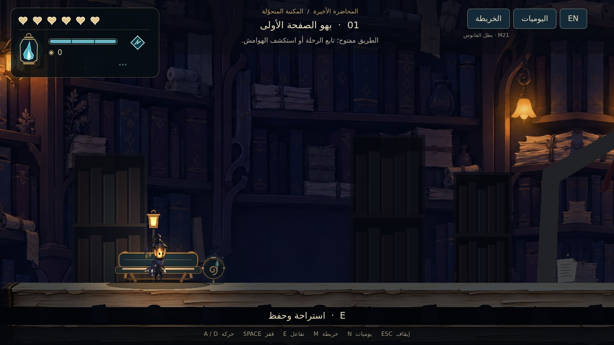

# LAST LECTURE — M21: ظلال الورق وعينان داخل الشعلة

بيئة ورقية أغمق وأقرب داخل **Godot 4.7.2 Standard**: جدران رفوف ومخطوطات قريبة، وطبقة وسطى مستقلة، وظلال كتب وأوراق أمام الأرضيات، مع إنارات محدودة وضوء فانوس متحرك يضيء المحيط. البطل هو رسم **M20 نفسه ببايتاته ونسبه وألوانه وحركاته**؛ أضيفت عينان داخل الشعلة فقط. بُسّط الرسم الداخلي للعدو الأول مع الحفاظ على هيئته وحركة قتاله.

**[تحميل المشروع كاملًا — M21 ZIP](https://github.com/thamrhntwl538-cell/-2d/archive/refs/heads/m21-paper-shadows.zip)** · **[البيئة والإضاءة](docs/M21_ENVIRONMENT_AR.md)** · **[العينان وأصل رسم البطل](docs/M21_HERO_EYES_AR.md)** · **[اختبار Godot](docs/M21_QA.md)**

**[فيديو البيئة والفانوس من Godot](previews/m21/24_paper_shadows_demo.mp4)** · [العينان والتعبيرات](previews/m21/20_hero_eyes.jpg) · [لقطة البطل والعدو](previews/m21/18_hero_eyes.jpg)

## التشغيل

1. نزّل ZIP وفك الضغط، واحتفظ بالمجلد كاملًا.
2. افتح **Godot4.7.2 Standard** واختر **Import** ثم ملف **`project.godot`** الموجود في جذر المجلد الناتج.
3. انتظر استيراد الرسوم، ثم اضغط **F5**. البداية مضبوطة على `scenes/stage_01/folding_library_m21.tscn`.

لمعاينة العينين فوق البطل مكبّرًا، افتح **`scenes/warden_m21_review.tscn`** واضغط **F6**؛ بدّل صفحات التعبيرات والحركة والضربات بـTab أو1/2/3، واختر الوضعية بالسهمين وأوقف الحركة والرمش بـSpace. هذه ساحة لفحص الرسم، بينما تختبر الحركة والقتال الفعليين في اللعبة بـF5. صور المراجعة المقرّبة تستخدم تكبير الكاميرا ولا تغيّر مقاس البطل داخل اللعبة.

تمتد الطبقات والإضاءة الجديدة إلى مناطق المكتبة الخمس عشرة. تبقى مساراتها ومنصاتها وألغازها وأنظمة الطاقة والفتائل محفوظة. يقرأ M21 ملفات حفظ M18–M20 نفسها؛ إذا كانت اليرقة مهزومة في حفظك، تبقى مهزومة. يمكن بدء تجربة جديدة من قائمة الإيقاف بعد التأكيد.

| الفعل | الكيبورد | يد التحكم |
|---|---|---|
| الحركة واتجاه الضربة | A/D وW/S أو الأسهم | العصا اليسرى أوD-pad |
| قفز | Space | A |
| ضرب | J | X |
| داش | K | RB |
| شق الحبر | L | B |
| العلاج مع الثبات | الضغط المطول علىH | الضغط المطول علىY |
| التفاعل | E | LB |
| خريطة | M | Back |
| يوميات | N أوTab | L3 |
| إيقاف | Esc | Start |
| العربية والإنجليزية | F2 | من قائمة الواجهة |

يمكن تغيير ربط الأزرار من **الإيقاف ← التحكم**؛ يحفظ ربط الكيبورد ويد التحكم كلًا على حدة. المسمياتA/B/X/Yتصف توزيع يدXbox، وتختلف الكتابة المطبوعة على أيدي أخرى.

## تجربة المواجهة الأولى

في المنطقة01 اجمع فتيل الاستمداد قرب المقعد، ثم أداة الحارس، ثم قدرة الداش قبل الدرج. جهّز الفتيل عند المقعد إذا أردت زيادة الوهج المكتسب؛ ليس الجمع وحده تجهيزًا. اعبر إلى02 وواجه **يرقة الخلل**: راقب انكماشها، تفاد الاندفاع الثابت، ثم اضرب أثناء التعافي. لا تحتاج إلى الصد أو الداش لهزيمتها.

تحتاج اليرقة إلى ثلاث إصابات سيف أساسية. جسمها اللين آمن، وفكها أثناء الاندفاع مؤذٍ؛ تلاقي السيف مع الجزء الهجومي المناسب يحدث صدًا دون زر منفصل. الانتصار الحقيقي يفتح الطريق إلى03 ويظهر غرض **شق الحبر** قرب أول درج في02. يمكن جمع فتيل المدى على الشرفة العليا في02، وتوسعة السعة في03، وفتيل السكينة قرب استراحة الأرشيف06.

الضربة السفلية الناجحة ترتد بالبطل وتعيد الداش الجوي. توجد حلقات نحاسية واضحة في المناطق الأولى تسمح بتجربة الارتداد البيئي دون منح طاقة مجانية.

## الطاقة والفتائل والموت

- ستة قلوب ومخزون مشترك99؛ إصابة السيف تمنح11أساسيًا، والعلاج أو التقنية يستهلكان33. لا تجدد تلقائيًا، والقدرة لا تشحن نفسها.
- العلاج يحتاج إلى ثبات1.141ثانية تقريبًا؛ يكلف33عند بدء المحاولة، والإصابة أو إلغاء العلاج لا يعيدان المبلغ. يمكن تعديل سرعة العلاج بفتيل السكينة.
- الفتائل الثلاثة: **الاستمداد** يزيد المكسب من11إلى13، **المدى** يمد السيف15%، و**السكينة** يقلل زمن العلاج20%. السعة المبدئية3وتوجد توسعة واحدة إلى4في هذا الإصدار. التبديل مجاني عند مقعد فعلي فقط.
- عند الموت تعود إلى آخر مقعد بكامل الصحة، وتحفظ الأسلحة والفتائل والقدرات والألغاز والانتصارات. تسقط العملة على أرض آمنة قرب موضع الموت؛ الاستعادة بتفاعلE/LB. موت ثان قبل الاستعادة يمحو الكومة السابقة، حتى إذا لم تحمل عملة جديدة.
- يستخدم M21 ملفات حفظ M18–M20 نفسها، فتستمر القدرات والفتائل والتقدم السابق؛ تبقى ملفات M17 مستقلة. البداية الجديدة من قائمة الإيقاف تحتاج إلى تأكيد.

## نطاق النسخة

هذه **أول مواجهة ونواة النظام**، وليست تنفيذًا لجميع خصائص اللعبة الكاملة. الضربات المشحونة المتقدمة، والكومبوات الجديدة المؤلفة، وتطوير الداش العابر، والأسلحة الإضافية، وبقية الأعداء والزعماء ومكافآتهم تأتي لاحقًا. القدرات الدائمة والفتائل المرتبطة بالزعماء موثقة كاتجاه معتمد؛ لا تمنح هذه النسخة انتصارًا أو ختمًا من ساحة فارغة.

بقية المناطق تحافظ على وضع معاينة البيئة منM17. بوابة02تتطلب قتل اليرقة فعليًا، أما مواضع الحارس والزعيم المستقبليين فلا تمثل قتالًا مكتملًا. العالم الثاني لم يضف بعد، ونهاية المعاينة منفصلة عن المغادرة الحقيقية.

حركة M20 ووقت تماس السيف وأقواسه النارية محفوظة، بما فيها القفز المتغير والداش والضرب أثناء الجري. يستخدم البطل أطلس M20 الأصلي؛ تتبع العينان ميل الفانوس واتجاه النظر، مع رمش خفيف. بقيت صحة اليرقة وسرعتها وتوقيت التحذير والاندفاع والتعافي ومناطق الإصابة كما كانت؛ يزيل رسمها الجديد التفاصيل الصغيرة والخدوش والزخارف الداخلية فقط.

[لقطات M21 من Godot](previews/m21) · [خلفيات البيئة](assets/environments/paper_shadows/art_manifest.json) · [رسم البطل المعتمد](assets/warden_m20/art_manifest.json) · [مصدر تبسيط العدو](assets/enemies/m21/art_manifest.json) · [نسخة M20 السابقة](https://github.com/thamrhntwl538-cell/-2d/tree/m20-hero-polish) · [اعتمادات الأصول السابقة](LICENSE_NOTES.txt)
