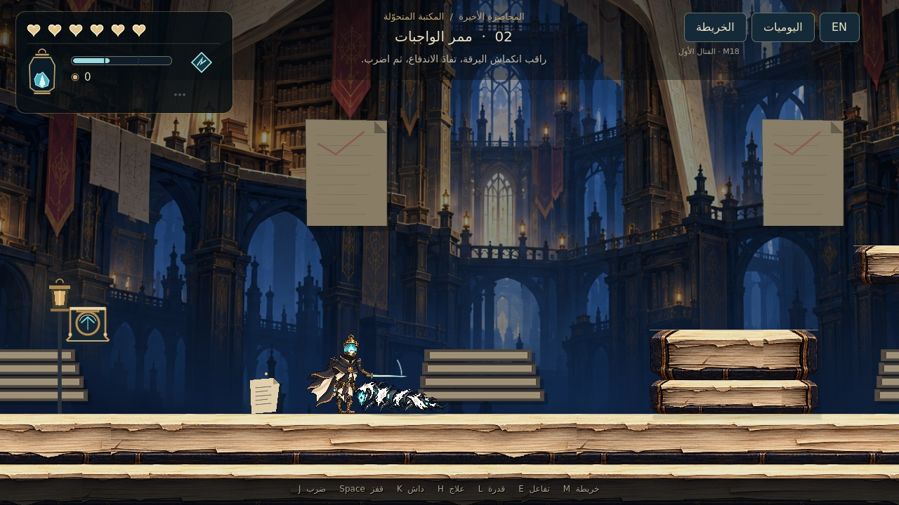

# LAST LECTURE — M18: يرقة الخلل ونواة القتال

أول عدو قابل للقتال داخل **Godot 4.7.2 Standard**، مبني على بيئة المكتبة المتحوّلة ذات15منطقة. يتضمن هذا الإصدار ضربات السيف الاتجاهية والارتداد السفلي، والداش المبكر بلا حصانة، وتقنية شق الحبر، والعلاج من مخزون طاقة مشترك، وثلاثة فتائل فعلية، وحفظ العملة المفقودة عند الموت.

**[تحميل المشروع كاملًا — M18 ZIP](https://github.com/thamrhntwl538-cell/-2d/archive/refs/heads/m18-combat-foundation.zip)** · **[مواصفات إجاباتك الأربعين](docs/M18_COMBAT_SPEC_AR.md)** · **[تفاصيل التنفيذ](docs/M18_IMPLEMENTATION_AR.md)** · **[اختبار Godot](docs/M18_QA.md)**

## التشغيل

1. نزّل ZIP وفك الضغط، واحتفظ بالمجلد كاملًا.
2. افتح **Godot4.7.2 Standard** واختر **Import** ثم ملف **`project.godot`** الموجود في جذر المجلد الناتج.
3. انتظر استيراد الرسوم، ثم اضغط **F5**. البداية مضبوطة على `scenes/stage_01/folding_library_m18.tscn`.

| الفعل | الكيبورد | يد التحكم |
|---|---|---|
| الحركة واتجاه الضربة | A/D وW/S أو الأسهم | العصا اليسرى أوD-pad |
| قفز | Space | A |
| ضرب | J | X |
| داش | K | RB |
| شق الحبر | L | B |
| العلاج مع الثبات | الضغط المطول علىH | الضغط المطول علىY |
| التفاعل | E | LB |
| خريطة | M | Back |
| يوميات | N أوTab | L3 |
| إيقاف | Esc | Start |
| العربية والإنجليزية | F2 | من قائمة الواجهة |

يمكن تغيير ربط الأزرار من **الإيقاف ← التحكم**؛ يحفظ ربط الكيبورد ويد التحكم كلًا على حدة. المسمياتA/B/X/Yتصف توزيع يدXbox، وتختلف الكتابة المطبوعة على أيدي أخرى.

## تجربة المواجهة الأولى

في المنطقة01 اجمع فتيل الاستمداد قرب المقعد، ثم أداة الحارس، ثم قدرة الداش قبل الدرج. جهّز الفتيل عند المقعد إذا أردت زيادة الوهج المكتسب؛ ليس الجمع وحده تجهيزًا. اعبر إلى02 وواجه **يرقة الخلل**: راقب انكماشها، تفاد الاندفاع الثابت، ثم اضرب أثناء التعافي. لا تحتاج إلى الصد أو الداش لهزيمتها.

تحتاج اليرقة إلى ثلاث إصابات سيف أساسية. جسمها اللين آمن، وفكها أثناء الاندفاع مؤذٍ؛ تلاقي السيف مع الجزء الهجومي المناسب يحدث صدًا دون زر منفصل. الانتصار الحقيقي يفتح الطريق إلى03 ويظهر غرض **شق الحبر** قرب أول درج في02. يمكن جمع فتيل المدى على الشرفة العليا في02، وتوسعة السعة في03، وفتيل السكينة قرب استراحة الأرشيف06.

الضربة السفلية الناجحة ترتد بالبطل وتعيد الداش الجوي. توجد حلقات نحاسية واضحة في المناطق الأولى تسمح بتجربة الارتداد البيئي دون منح طاقة مجانية.

## الطاقة والفتائل والموت

- ستة قلوب ومخزون مشترك99؛ إصابة السيف تمنح11أساسيًا، والعلاج أو التقنية يستهلكان33. لا تجدد تلقائيًا، والقدرة لا تشحن نفسها.
- العلاج يحتاج إلى ثبات1.141ثانية تقريبًا؛ يكلف33عند بدء المحاولة، والإصابة أو إلغاء العلاج لا يعيدان المبلغ. يمكن تعديل سرعة العلاج بفتيل السكينة.
- الفتائل الثلاثة: **الاستمداد** يزيد المكسب من11إلى13، **المدى** يمد السيف15%، و**السكينة** يقلل زمن العلاج20%. السعة المبدئية3وتوجد توسعة واحدة إلى4في هذا الإصدار. التبديل مجاني عند مقعد فعلي فقط.
- عند الموت تعود إلى آخر مقعد بكامل الصحة، وتحفظ الأسلحة والفتائل والقدرات والألغاز والانتصارات. تسقط العملة على أرض آمنة قرب موضع الموت؛ الاستعادة بتفاعلE/LB. موت ثان قبل الاستعادة يمحو الكومة السابقة، حتى إذا لم تحمل عملة جديدة.
- ملفاتM18مستقلة عنM17؛ لا تكتب هذه النسخة فوق حفظ الإصدار السابق. البداية الجديدة من قائمة الإيقاف تحتاج إلى تأكيد.

## نطاق النسخة

هذه **أول مواجهة ونواة النظام**، وليست تنفيذًا لجميع خصائص اللعبة الكاملة. الضربات المشحونة المتقدمة، والكومبوات الجديدة المؤلفة، وتطوير الداش العابر، والأسلحة الإضافية، وبقية الأعداء والزعماء ومكافآتهم تأتي لاحقًا. القدرات الدائمة والفتائل المرتبطة بالزعماء موثقة كاتجاه معتمد؛ لا تمنح هذه النسخة انتصارًا أو ختمًا من ساحة فارغة.

بقية المناطق تحافظ على وضع معاينة البيئة منM17. بوابة02تتطلب قتل اليرقة فعليًا، أما مواضع الحارس والزعيم المستقبليين فلا تمثل قتالًا مكتملًا. العالم الثاني لم يضف بعد، ونهاية المعاينة منفصلة عن المغادرة الحقيقية.

حركة الجري والقفز المعتمدة محفوظة، وحركات الضرب والإصابة والموت تستخدم الآن أجزاء نموذجM13نفسها بدل نموذج القتال القديم؛ كل الحركة والتصادم والضرب والطاقة والعلاج والواجهة أنظمة فعلية داخل Godot. لا يعد قرب المرجع ادعاءً بمطابقة توقيتاته إطارًا بإطار؛ انظر [المراجع وحدود المطابقة](docs/M18_COMBAT_REFERENCES.md).

[لقطاتM18منGodot](previews/m18) · [نسخةM17السابقة](https://github.com/thamrhntwl538-cell/-2d/tree/m17-folding-library) · [مصادر الفن الجديد](assets/enemies/m18/art_manifest.json) · [اعتمادات الأصول السابقة](LICENSE_NOTES.txt)
