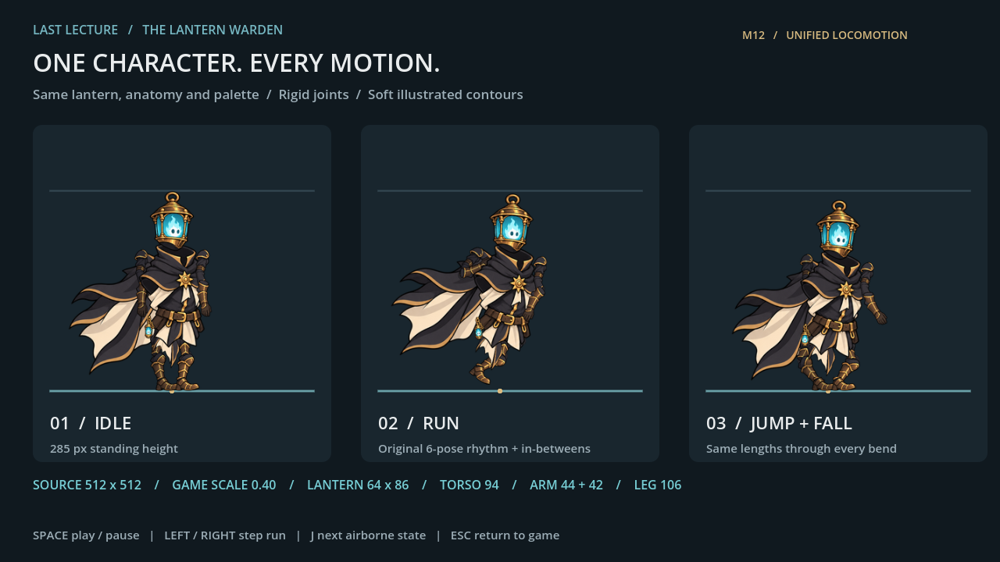

# LAST LECTURE — Lantern Warden M12

المشروع الكامل للعبة Godot، مع الرسومات والمصادر الفنية والمراحل السابقة وأدوات الاختبار. توحّدت نسب البطل وألوانه وتفاصيله بين الوقوف والجري والقفز، مع رسم أنعم والحفاظ على إيقاع الجري الأصلي.

**[تحميل المشروع الكامل ZIP](https://github.com/thamrhntwl538-cell/-2d/releases/download/m12/LastLecture_Godot_Warden_M12_Unified.zip)** · **[صفحة إصدار M12](https://github.com/thamrhntwl538-cell/-2d/releases/tag/m12)**

## التشغيل

1. نزّل ملف ZIP من إصدار M12 وفكّ الضغط.
2. افتح `project.godot` في **Godot 4.6 أو أحدث**.
3. اضغط **F5** لتشغيل اللعبة. الحركة A/D، والقفز Space.
4. للمقارنة: افتح `scenes/warden_m12_review.tscn` واضغط **F6**.

يمكنك أيضًا تنزيل المستودع من **Code → Download ZIP**، ثم فتح `project.godot` في مجلد المستودع.

## ما تتضمنه M12

- 83 إطارًا جديدًا من نموذج فني موحّد، مع مصدر الرسم والمفاصل القابلة للتعديل.
- ارتفاع الوقوف 285 بكسل، وحجم الفانوس 64 × 86، ومقياس اللعب الثابت 0.40.
- أطوال ثابتة للجذع والأطراف، ومفصل كاحل يحافظ على تماس القدم بالأرض عند الهبوط.
- دورة الجري الأصلية `6 / 13` ثانية، مع إطارات انتقالية إضافية.
- المشروع الكامل وأصول المراحل السابقة محفوظة في المستودع. مجلد `.godot` المحلي يُعاد إنشاؤه عند الاستيراد.

**Slash ورسوم القتال السابقة مؤجّلة للمرحلة التالية؛ لم يُعد رسمها في M12.**

## التحقق والمعاينة

اختُبرت الحركة فعليًا في **Godot 4.6.3 / OpenGL Compatibility / llvmpipe**، خلال 303 خطوات فيزيائية، قبل تجهيز السلاح وبعده. اجتازت الإطارات الـ83 فحص المقاسات والشفافية وأطوال المفاصل.

- [التوثيق العربي الكامل](README_M12_AR.md)
- [فيديو المقارنة واللعب](previews/Warden_M12_Preview.mp4)
- [تقرير التسليم](WARDEN_M12_DELIVERY_QA.json)
- [نتيجة اختبار اللعب](WARDEN_M12_GAMEPLAY_QA.json)
- [نتيجة فحص الأصول](WARDEN_M12_ASSET_QA.json)

الأصول السابقة مأخوذة من ملفات المشروع المرفقة، مع تفاصيل المصدر في [LICENSE_NOTES.txt](LICENSE_NOTES.txt).
