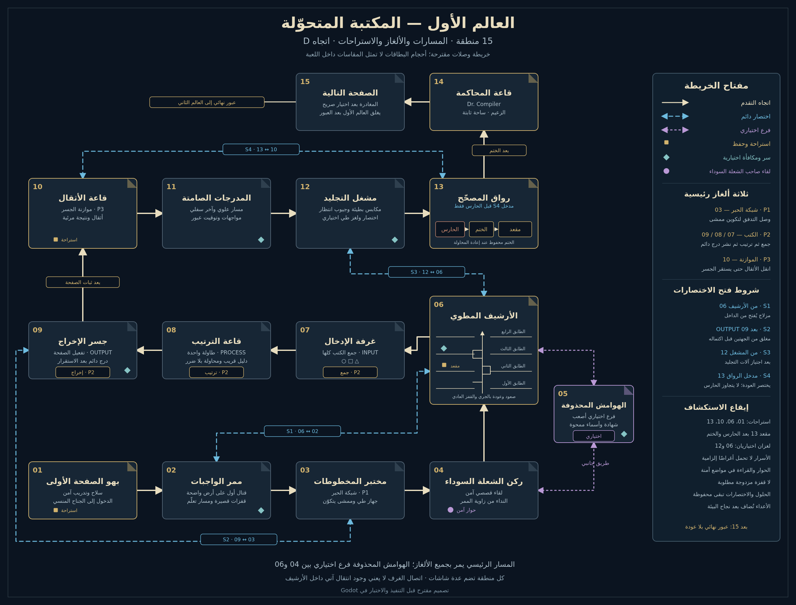
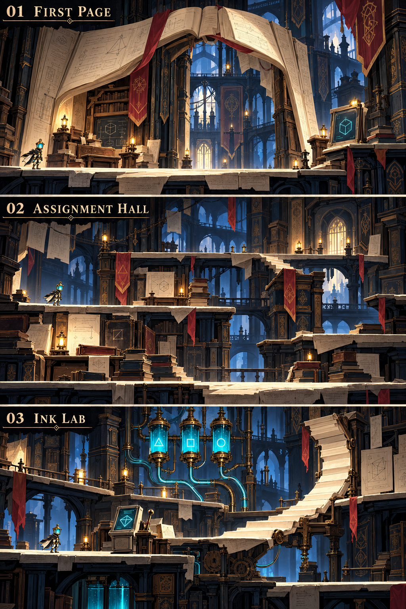
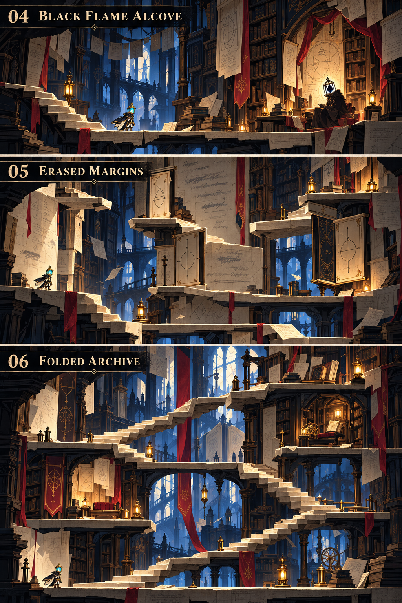
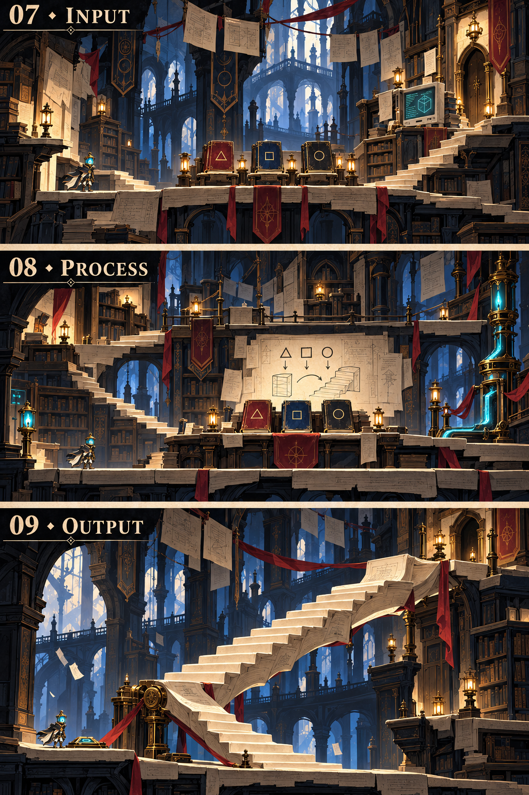
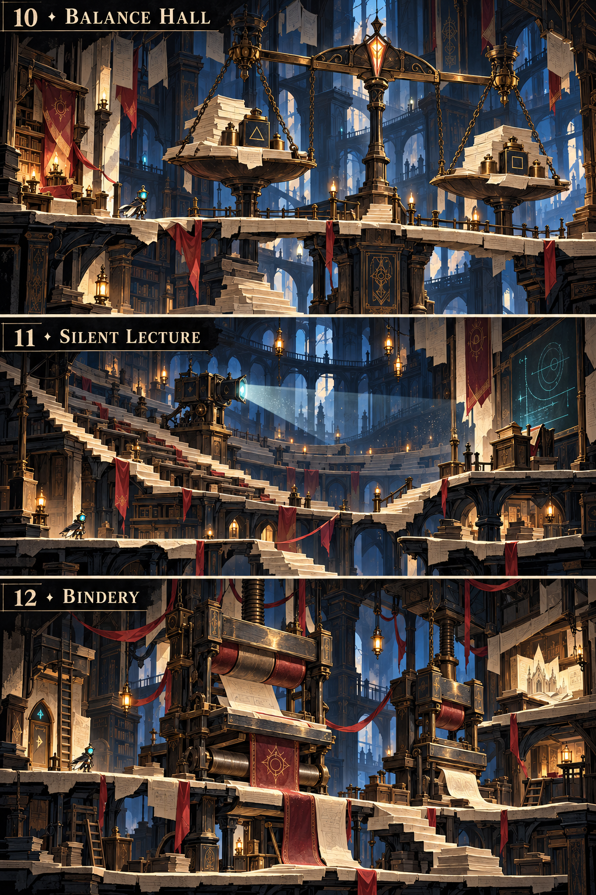
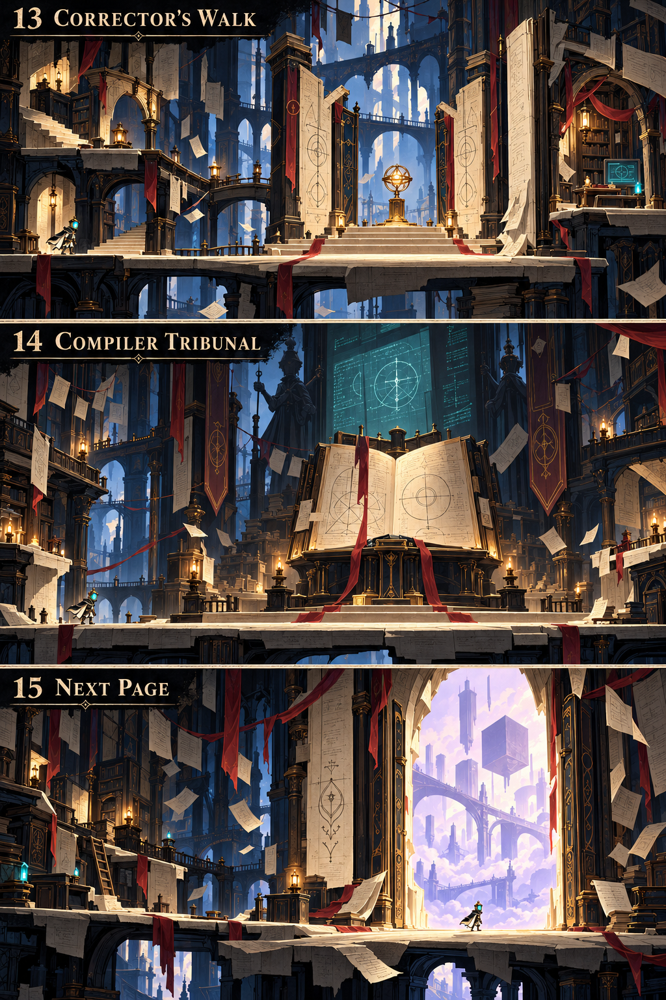

# LAST LECTURE — العالم الأول: المكتبة المتحوّلة

**تصميم معتمد من المستخدم بتاريخ2026-10-22.** [سجل الاعتماد ونطاقه](APPROVAL_AR.md).

المخطط الكامل للاتجاه **D** بعد توسيعه إلى **15 منطقة**: نحو40 مساحة لعب مقترحة، ومسار رئيسي وفرع استكشاف وأربعة اختصارات، وثلاثة ألغاز رئيسية واثنين اختياريين، وأربع استراحات وستة أسرار.

**[افتح الخريطة الكاملة بالحجم الأصلي](WORLD_01_MAP.png)** · **[شاهد شرح الألغاز بالرسوم](PUZZLES_GUIDE.png)** · **[اقرأ مواصفات العالم والمسارات والألغاز](WORLD_01_AR.md)** · **[تنزيل الحزمة ZIP](https://github.com/thamrhntwl538-cell/-2d/archive/refs/heads/stage1-library-design.zip)**

## صور المناطق الخمس عشرة

خمس لوحات، في كل لوحة ثلاثة مشاهد مرتبة من الأعلى إلى الأسفل. اضغط اسم اللوحة لفتح الصورة بالحجم الكامل. العناوين الإنجليزية داخل الصور تطابق الأرقام والأسماء العربية أدناه.

| اللوحة | المشهد العلوي | المشهد الأوسط | المشهد السفلي |
|---|---|---|---|
| **[01–03: المدخل والواجبات والمختبر](ART_01_03.png)** |01 بهو الصفحة الأولى · First Page |02 ممر الواجبات · Assignment Hall |03 مختبر المخطوطات · Ink Lab |
| **[04–06: الغريب والهوامش والأرشيف](ART_04_06.png)** |04 ركن الشعلة السوداء · Black Flame Alcove |05 الهوامش المحذوفة · Erased Margins |06 الأرشيف المطوي · Folded Archive |
| **[07–09: الإدخال والترتيب والإخراج](ART_07_09.png)** |07 غرفة الإدخال · INPUT |08 قاعة الترتيب · PROCESS |09 جسر الإخراج · OUTPUT |
| **[10–12: الأثقال والمدرجات والمشغل](ART_10_12.png)** |10 قاعة الأثقال · Balance Hall |11 مدرجات المحاضرة الصامتة · Silent Lecture |12 مشغل التجليد · Bindery |
| **[13–15: الحارس والمحاكمة والعبور](ART_13_15.png)** |13 رواق المصحّح · Corrector's Walk |14 قاعة المحاكمة · Compiler Tribunal |15 الصفحة التالية · Next Page |

### 01–03

### 04–06

### 07–09

### 10–12

### 13–15

## المسارات والألغاز

المسار الرئيسي: `01 → 02 → 03 → 04 → 06 → 07 → 08 → 09 → 10 → 11 → 12 → 13 → 14 → 15`.

الهوامش المحذوفة فرع اختياري: `04 ↔ 05 ↔ 06`. تفتح وصلات العودة الدائمة من الداخل: **06↔02**، و**09↔03** بعد اكتمال OUTPUT، و**12↔06** بعد المشغل، و**مدخل13↔10** قبل ساحة الحارس. لا تتجاوز أي وصلة لغزًا إلزاميًا أو الختم أو الزعيم.

1. **شبكة الحبر في03:** توصيل قنوات ظاهرة لتشغيل آلة تطوي ممشى جديدًا.
2. **منظومة الكتب في07–09:** جمع الكتب الثلاثة△□○ كلها، ثم ترتيبها معًا على طاولة واحدة، ثم نشر درج دائم من موضع آمن.
3. **ميزان التجليد في10:** نقل أثقال مرئية لموازنة جسر؛ النتيجة تظهر بعد كل حركة.

لغزا الأسرار في06 و12: مطابقة صفحات شفافة وكتاب مجسّم ذو طيات متعددة. الخطأ في الألغاز الرئيسية لا يفقد كتابًا أو موردًا ولا يسبب ضررًا، والحلول والاختصارات تبقى محفوظة. تحديات الحركة تتدرج في الأرشيف والمكابس والمدرجات مع مسارات انتظار وعودة واضحة.

الاستراحات في **01 و06 و10 و13**. مقعد13 بعد الحارس والختم؛ اختصار المنطقة يصل إلى الدهليز قبلهما. سبعة أنواع أعداء ومواجهة د. كومبايلر مستقلة محجوزة في المخطط، وتأتي بعد نجاح البيئة والتنقل.

## القرارات المعتمدة من المستخدم

- **يغلق العالم الأول بعد مغادرته.** بوابة15 تتطلب اختيارًا صريحًا بعد الزعيم؛ يستطيع اللاعب الإلغاء وإكمال الاستكشاف قبل العبور. تُحفظ اليوميات المقروءة، ولا تعتمد العوالم اللاحقة على سر اختياري فات هنا.
- **العربية والإنجليزية مع خيار تبديل** للنصوص والحوارات داخل اللعبة.
- **تصميم صاحب الشعلة السوداء مؤجل:** يظهر كظل في صور البيئة؛ مظهره في اللوحات مؤشر للمكان والجو، وليس تصميم شخصية نهائيًا.

## مرجع التنفيذ

[WORLD_01_AR.md](WORLD_01_AR.md) يشرح المناطق والأسرار والإنصاف والحفظ. [world1_design.json](world1_design.json) يحتوي بيانات الغرف والشروط والأحداث، و[map_layout.json](map_layout.json) يحدد الوصلات التخطيطية. [نسخة SVG قابلة للتكبير](WORLD_01_MAP.svg)، و[دليل رسم البيئة](ART_GUIDE_AR.md)، و[مراجعة الاتساق](REVIEW_AR.md).

هذه حزمة تصميم وصور تصورية للبيئة، وليست نسخة Godot جديدة. الخريطة الهندسية مرجع الوصلات، بينما اللوحات مرجع الفن والتكوين؛ المسافات والمنصات وأعداد الكتب الزخرفية في الرسم لا تحل محل هندسة اللعب. المقاسات والتصادم والحركة تحتاج اختبارًا فعليًا في Godot عند البناء. يبقى البطل بتصميمه ونسبه وألوانه وحركة جريه المعتمدة.

المخطط الحالي ذو15منطقة يحل محل مسودة العشر مناطق السابقة الموجودة في تاريخ الفرع. النسخة القابلة للتجربة حاليًا هي [مشروع M16](https://github.com/thamrhntwl538-cell/-2d/archive/refs/tags/m16.zip)؛ بيئة المكتبة الجديدة قيد التصميم.
