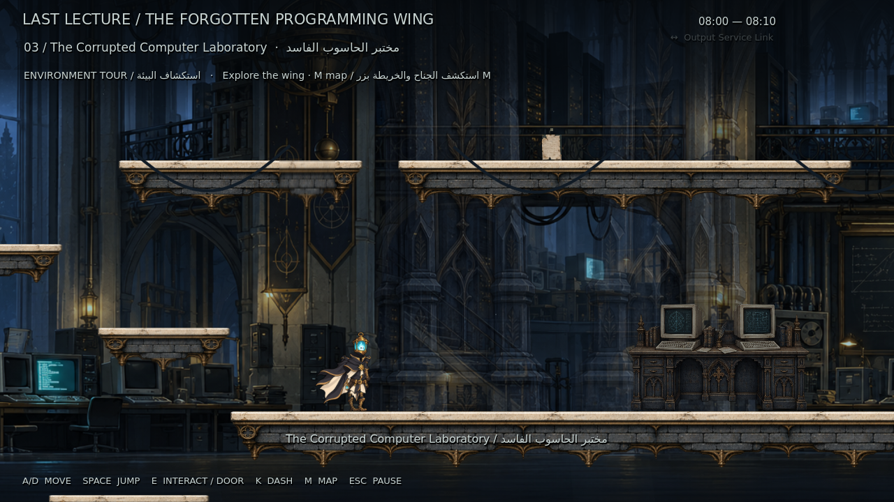
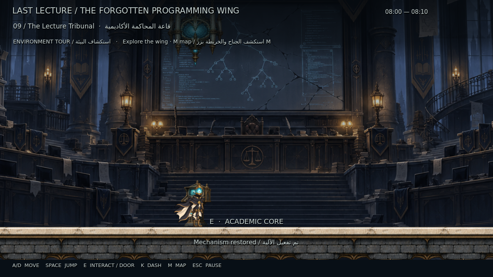

# LAST LECTURE — M15: The Forgotten Programming Wing

بيئة المرحلة الأولى صارت **عشر غرف مترابطة قابلة للاستكشاف**: المدخل، ردهة الواجبات، مختبر الحاسوب، الأرشيف الرأسي، INPUT وPROCESS وOUTPUT، ممر الاقتراب، قاعة المحاكمة، وممر ما بعدها. البطل ورسوماته وحركة M13 محفوظة.

**[تحميل المشروع كاملًا — M15 ZIP](https://github.com/thamrhntwl538-cell/-2d/archive/refs/tags/m15.zip)** · **[صفحة الإصدار](https://github.com/thamrhntwl538-cell/-2d/releases/tag/m15)** · **[معاينة الغرف والمصعد داخل Godot](previews/m15/Forgotten_Wing_Godot.mp4)**

## التشغيل

1. نزّل ZIP وفك الضغط. احتفظ بالمجلد كاملًا.
2. من Godot اختر **Import** وافتح `project.godot` داخل `-2d-m15`.
3. اضغط **F5**. تفتح جولة البيئة المترابطة مباشرة.

**A/D** أو الأسهم للحركة، **Space** للقفز، **E** للتفاعل وعبور الأبواب، **K** للاندفاع، **M** للخريطة، **Esc** للإيقاف. لا تحتاج إلى اندفاع أو سلاح لإكمال مسار البيئة.

في المدخل اصعد إلى جهاز الشرفة لتفتح البوابة. اقترب من المخرج واضغط E للانتقال. في الأرشيف قف على المصعد واضغط E لكل طابق، أو اطلبه من جهاز الشرفة؛ توجد أيضًا درجات فعلية للصعود. فعّل **INPUT ثم PROCESS ثم OUTPUT** لفتح الطريق والاختصار. المقاعد تحفظ التقدم؛ قائمة الإيقاف تتيح إعادة البداية.

## نطاق النسخة

هذه **جولة البيئة** قبل تنفيذ الأعداء والزعيم، حسب أولوية المشروع. تتيح زيارة قاعات القتال المستقبلية عبر وضع معاينة واضح، مع بقاء مفتاح الزعيم ونتائج المواجهات والانتصار غير مكتسبة. أبواب اللغز والاختصارات تتطلب تفاعلاتها الحقيقية. عند تعطيل وضع المعاينة، تظل أقفال القتال مغلقة حتى ربط نتائج المواجهات لاحقًا.

الاختبار الفعلي على **Godot 4.6.3**. لم يُختبر Godot4.7 هنا. الرسوم الجديدة أول تمرير فني قابل للمراجعة؛ الأعداء ورسوم Slash والقتال لم تتغير.

## التنفيذ والاختبار

- [خريطة الغرف والاختصارات](docs/M15_STAGE_MAP.md)
- [طريقة اللعب وبنية المشروع](docs/M15_IMPLEMENTATION_AR.md)
- [هوية الرسم والأصول](docs/M15_ENVIRONMENT_ART_DIRECTION_AR.md)
- [تقرير الاختبار وحدوده](docs/M15_TEST_REPORT_AR.md)
- [نتائج الجولة الفعلية](M15_ENVIRONMENT_QA.json) · [التشغيل المرئي](M15_VISUAL_REVIEW.json)

نجح اختبار Godot في9614 دورة فيزيائية، منها8572 خلال جولة بإدخال فعلي عبر الغرف العشر، مع14 انتقالًا و20 هبوطًا، والاختصارين في الاتجاهين، وصعود المصعد2040 بكسل، والممر السري والحفظ والاسترجاع. لم يُنقل اللاعب أو يُحقن التقدم خلال الجولة. صور الغرف وفيديو المعاينة من تشغيل مرئي منفصل داخل المحرك.

الإصدارات السابقة محفوظة: [M14 المدخل](https://github.com/thamrhntwl538-cell/-2d/releases/tag/m14)، [M13 حركة البطل](https://github.com/thamrhntwl538-cell/-2d/releases/tag/m13). نموذج القتال القديم في `scenes/main.tscn`، والمدخل المستقل في `scenes/stage_01/silent_entrance.tscn`.

مصادر الأصول والخطوط في [LICENSE_NOTES.txt](LICENSE_NOTES.txt).
