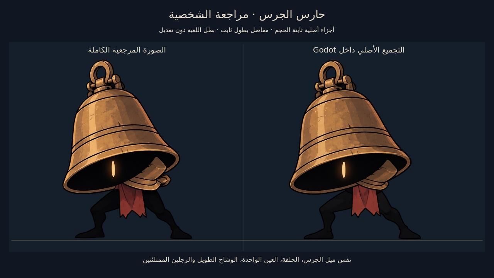

# LAST LECTURE — M24: حارس الجرس

أول ميني بوس من الأربعة المعتمدين، برسم مطابق لاتجاه المرجع: جرس برونزي مائل، عين واحدة، جذع أسود، وشاح أحمر طويل ورجلان ممتلئتان. الشخصية مركّبة من أجزاء ثابتة الحجم وتستخدم الرسم نفسه في المعاينة واللعب. البطل المعتمد ورسومه ونسبه محفوظة.

**[تحميل مشروع Godot كاملًا — M24 ZIP](https://github.com/thamrhntwl538-cell/-2d/archive/refs/heads/m24-bell-warden.zip)** · [الشخصية](docs/M24_CHARACTER_AR.md) · [فحوص النسخة](docs/M24_QA.md)

[فيديو أصلي من المحرك مع الصوت والقتال](previews/m24/40_bell_native_demo.mp4) · [الأجزاء](previews/m24/11_character_parts.jpg) · [الحركة](previews/m24/13_character_motion.jpg) · [البيئة](previews/m24/21_arena_after.jpg)

## التشغيل

1. نزّل ZIP وفك الضغط، واحتفظ بالمجلد كاملًا.
2. افتح **Godot 4.7.2 Standard**، واختر **Import** ثم **`project.godot`** في جذر المجلد، وانتظر استيراد الأصول.
3. اضغط **F5**؛ تبدأ بمعاينة الشخصية أولًا. الأرقام **1–4** تعرض المرجع والأجزاء والمقاسات والحركة. **Tab** للأجزاء، و**Space** للتنفس، و**G** للمفاصل.
4. اضغط **Enter** أو زر **A** للدخول إلى تجربة الجرس. على يد التحكم استخدم **LB/RB** أو اتجاه اليمين واليسار للتنقل بين صفحات المعاينة.
5. داخل التجربة تحرك يمينًا من الاستراحة لدخول الساحة. **Esc ← العودة من تجربة الزعيم** يفتح المكتبة؛ يمكن دخول تجربة الجرس من قائمة المكتبة أيضًا.

المشهد الافتراضي `scenes/minibosses/bell_character_review_m24.tscn`. التجربة `scenes/minibosses/bell_trial_m24.tscn`، والمكتبة `scenes/stage_01/folding_library_m24.tscn`؛ يمكن فتح أي منها في المحرر واستخدام F6.

## الشخصية قبل القتال

ارتفاع الحارس **194 بكسل** مقابل **104 بكسلات** للبطل. توجد معاينة للصورة المجمعة المصدرية مقابل التجميع الحقيقي، وأخرى تفكك الجرس والجذع والوشاح والرجلين. العظام ثابتة الطول، والقدمان ترتكزان على الأرض أثناء المشي؛ الاندفاعة قفزة منخفضة حقيقية بارتفاع 8 بكسلات مع ضم القدمين. لم تُعدّل بكسلات أطلس البطل أو الرسم المفصول بعد توليده.

الصور ذات اللوحات والشبكات مراجعات تشكيل مضبوطة داخل Godot. الفيديو يبدأ بأربع ثوانٍ من مراجعة أوضاع معلنة، ثم يعرض دخولًا وقتالًا آليًا بإدخالات فعلية وانتصارًا حقيقيًا. لا يدعي تجربة لعب بشرية أو قياس أداء الأجهزة.

## مواجهة حارس الجرس

- **18 صحة**: اقتراب بخطوتين، تأرجح واندفاعة، قفزة ثقيلة، وموجات برونزية بعد الاصطدام بالأرض. تحت نصف الصحة يضيف قفزتين متتاليتين.
- لا رسائل هجمات، ولا شريط تحذير، ولا علامات أرضية مسبقة، ولا صفير أو تغير موسيقي يتنبأ بالهجمة. التعلم من الحركة الفعلية وتتابعها. الجسم آمن أثناء الانتظار والتعافي، ويؤذي أثناء الاندفاعة والسقوط؛ يمكن صد الحافة الأمامية أثناء الاندفاعة.
- المكان في **مشغل التجليد — الغرفة 12**، مع استراحة خارج كل طرف من الساحة. المعدات القديمة ساكنة على الأطراف ولا تسبب ضررًا خفيًا. الصفحات والاختصارات والمنصات الأصلية محفوظة.
- الفوز يمنح **45 عملة فعلية قابلة للجمع** وتوسعة واحدة لسعة الفتائل. تحفظ الهزيمة والمكافأة مرة واحدة؛ لا تمنح علم انتصار الزعيم الرئيسي.
- التجربة مستقلة: ستة فوانيس صحة وطاقة 99 وسعة 4، مع السيف القصير والداش والتقنية. ملفها `user://bell_trial_m24.json`، وتبدأ محاولة جديدة عند دخولها من جديد. الموت يعيدك إلى الاستراحة الآمنة، وقاعدة سقوط العملة تبقى فعالة.

**الاستجابة للأصوات مرتبطة بالفعل نفسه**: خطوات، احتكاك القماش، صوت أجوف للشخصية، إصابة ورنين اصطدام وسقوط. الموسيقى الأصلية مقطع مستمر من 40 ثانية مع خاتمة انتصار؛ لا يرتبط تغيرها باستعداد هجمة.

[الصوت](docs/M24_AUDIO_AR.md) · [الموسيقى](docs/M24_MUSIC_AR.md) · [البيئة](docs/M24_ENVIRONMENT_AR.md) · [معرض العينات](docs/M24_PREVIEWS_AR.md)

## التحكم

| الفعل | الكيبورد | يد التحكم |
|---|---|---|
| الحركة واتجاه الضربة | A/D وW/S أو الأسهم | العصا اليسرى أوD-pad |
| قفز | Space | A |
| ضرب | J | X |
| داش | K | RB |
| شق الحبر | L | B |
| العلاج مع الثبات | الضغط المطول علىH | الضغط المطول علىY |
| التفاعل | E | LB |
| خريطة | M | Back |
| يوميات | N أوTab | L3 |
| إيقاف | Esc | Start |
| العربية والإنجليزية | F2 | من قائمة الواجهة |

يمكن تغيير ربط الأزرار من **الإيقاف ← التحكم**؛ يحفظ ربط الكيبورد ويد التحكم كلًا على حدة. المسمياتA/B/X/Yتصف توزيع يدXbox، وتختلف الكتابة المطبوعة على أيدي أخرى.

## العملات والصحة والطاقة

[تفاصيل العملات والواجهة والتحقق](docs/M22_CURRENCY_AND_HUD_AR.md).

تسقط عملات فعلية من الأعداء، وتظهر مكافآت الألغاز وفتح الممرات بعد إنجازها. اقترب لتنجذب العملات وتدخل رصيدك؛ لا يضاف مبلغ القتل قبل جمعها. العملات التي لم تجمعها تبقى محفوظة في منطقتها، ولا تعاد مكافأة مصدر مكتمل. السوق ومهام الشخصيات يأتيان لاحقًا؛ يستخدمان الرصيد ومسار المكافأة نفسه.

الصحة ستة فوانيس صغيرة تنطفئ نارها عند الضرر وتعود بالعلاج. الدائرة الكبيرة هي طاقة العلاج والقدرات المشتركة؛ تمتلئ بإصابة السيف. لا تجدد مجانيًا، ولا تمثل عددًا منفصلًا من شحنات العلاج.

## استكشاف المكتبة بعد العودة من التجربة

اجمع أداة الحارس والداش في01، ويمكن جمع الفتيل وتجهيزه عند المقعد. اقرأ الصفحة فوق رفها الجانبي، ثم اعبر إلى02. راقب تحذير اليرقة، تفاد اندفاعها واضرب خلال التعافي؛ ثلاث ضربات تكفي. الانتصار الحقيقي يفتح03 ويتيح جمع شق الحبر. المواجهتان الجديدتان في شرفات جانبية، وليستا حاجزين أمام القراءة أو الألغاز الأساسية.

الطريق الأساسي يحتفظ بتوصيل الحبر ثم جمع الكتب وترتيبها ثم موازنة الجسر، وبالممرات المختصرة المعتمدة. الأرشيف يحتفظ بالصعود متعدد المستويات. يمكن استكشاف05 من ركن الشعلة السوداء لتجربة لغز المصابيح.

ستة فوانيس صحة بداخلها نار، ودائرة طاقة كبيرة بمخزون مشترك99. السيف يجدد الطاقة؛ العلاج والقدرة يستهلكانها. الفتائل تبدل عند المقاعد فقط. عند الموت تبقى القدرات والتجهيزات والألغاز والانتصارات، وتسقط العملة للاستعادة؛ الموت مرة أخرى يمحو الكومة السابقة. [تفاصيل القتال والفتائل المعتمدة](docs/M18_COMBAT_SPEC_AR.md).

## نطاق النسخة

هذه النسخة تنفذ **حارس الجرس، الميني بوس الأول**. أمين الأرشيف وقاطع الهوامش وقارورة الحبر هم الميني بوسات التالية المعتمدة، و**نائم الرفوف** هو الزعيم الرئيسي المعتمد للعالم الأول؛ معاركهُم لم تُضف في M24. غرفة الزعيم الرئيسي محجوزة له، ومعركة د. كومبايلر القديمة باقية في مشهد M23 للمراجعة التاريخية.

المكتبة ذات المناطق الخمس عشرة واليوميات والألغاز وثلاثة أنواع الأعداء السابقة باقية. اجتياز المناطق كلها لم يُكرر لهذا التغيير المحدد. تُعاد فتح معاينة قديمة مكتملة للوصول إلى محتوى الجرس، مع إبقاء القدرات والمقاعد والألغاز والعملات وإيصالات القصة. لا يُعاد فتح عالم غادره اللاعب فعليًا.

[التحقق والتفاصيل](docs/M24_QA.md) · [اعتمادات الأصول](LICENSE_NOTES.txt) · [ترخيص الأصوات](assets/audio/m24/LICENSE.txt) · [ترخيص الموسيقى](assets/audio/m24/music/LICENSE.txt) · [نسخة M23 السابقة](https://github.com/thamrhntwl538-cell/-2d/tree/m23-compiler-boss)
