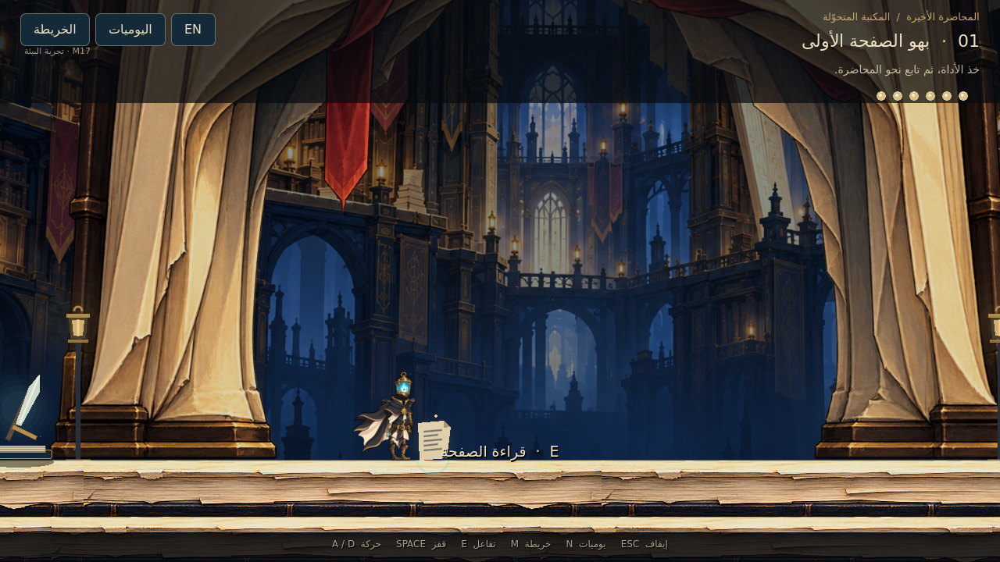

# LAST LECTURE — M17: المكتبة المتحوّلة

تنفيذ قابل للتجربة داخل **Godot4.6.3** لبيئة العالم الأول المعتمدة: **15منطقة مترابطة، وأرشيف بأربعة طوابق، وأربعة اختصارات، وثلاثة ألغاز رئيسية واثنين اختياريين، وأربع استراحات وستة أسرار**. البطل M13 ونسبه وألوانه وحركة جريه محفوظة.

**[تحميل المشروع كاملًا — M17 ZIP](https://github.com/thamrhntwl538-cell/-2d/archive/refs/heads/m17-folding-library.zip)** · **[تفاصيل التنفيذ](docs/M17_IMPLEMENTATION_AR.md)** · **[تقرير اختبار Godot](docs/M17_QA.md)**

## التشغيل

1. نزّل ZIP وفك الضغط، واحتفظ بالمجلد كاملًا.
2. افتح Godot واختر **Import**، ثم اختر ملف **`project.godot`** الموجود في جذر المجلد الناتج.
3. انتظر استيراد الرسوم، ثم اضغط **F5**. مشهد البداية هو `scenes/stage_01/folding_library.tscn`.

**A/D أو الأسهم** للحركة، **Space** للقفز، **E** للتفاعل وعبور الأبواب، **M** للخريطة، **N أو Tab** لليوميات، **F2** لتبديل العربية والإنجليزية، و**Esc** للإيقاف أو إغلاق نافذة القراءة. يمكن إكمال الطريق بالجري والقفزة العادية؛ الاندفاع اختياري.

عند الاقتراب من كتاب أو جهاز أو باب تظهر إشارة التفاعل. تبدأ الرحلة بأداة الحارس والتدريب، ثم شبكة الحبر. اقرأ تحذير الغريب وشهادات الأرشيف، واجمع الكتب الثلاثة في INPUT، ورتبها معًا في PROCESS، ثم انشر درج OUTPUT. تبقى حلول الألغاز والاختصارات محفوظة. قائمة الإيقاف تتيح بداية جديدة بعد تأكيد.

## البيئة والأنظمة

- **هندسة لعب فعلية:** منصات وتصادمات وأبواب ودرجات أصلية داخل Godot، مع طبقات عمق تتحرك مع الكاميرا.
- **ثمانية أصول فنية أصلية جديدة:** خمس خلفيات للعائلات البيئية، وقوس كتاب شفاف، وملمس منصات كتاب مرسوم، ومنظر للسماء والهندسة خلف البوابة الأخيرة. المعالم والتفاعلات مستقلة عن الصور.
- **ألغاز تفاعلية:** قنوات حبر قابلة للتدوير، ترتيب كتب وفق دليل قريب، وموازنة بأثقال تتحرك بين الكفتين؛ إضافة إلى لغزي الأسرار.
- **طي آمن ومحفوظ:** ينتظر اللاعب على أرض ثابتة، ثم تظهر هندسة الدرج بعد استقرار الحركة. المحاولة الخاطئة لا تفقد كتبًا أو موارد.
- **استكشاف وحوار:** الغريب ظل مؤقت، وشهادات متعارضة ومذكرات قابلة للعودة في اليوميات، مع تبديل اللغة دون فقد حالة القراءة.
- **مكابس التجليد:** إنذار قبل الحركة وجيوب انتظار، ثم ممشى خدمة دائم بعد اجتياز المشغل.
- **حفظ مستقل لنسخة M17:** تبقى ملفات حفظ M15/M16 كما هي. المقاعد تحفظ التقدم، وإعادة المحاولة تبقي الآليات المحلولة مفتوحة.

## نطاق هذه النسخة

هذه **نسخة البيئة قبل إضافة الأعداء والزعيم وSlash**. وضع الاستكشاف يتيح زيارة ساحاتهم دون منح انتصار أو ختم صوري. لغز البيئة واختصاراتها يتطلبان الحل الفعلي. في نهايتها يمكن اختيار إنهاء المعاينة عند بوابة العالم التالي؛ البعد الثاني نفسه يأتي لاحقًا. المغادرة الفعلية في تصميم اللعبة تظل مرتبطة بالزعيم ووجهة آمنة في العالم الثاني.

هدف60–90دقيقة يخص تصميم العالم المكتمل بقتاله واستكشافه، وليس زمنًا مقاسًا لهذه الجولة. [تقرير M17](docs/M17_QA.md) يميز بين جولة مدخلات حركة فعلية، واختبارات المنع المعزولة، ولقطات العرض.

## الصور والمراجع

[ركن الشعلة السوداء](previews/m17/04_black_flame_alcove.png) · [الأرشيف](previews/m17/06_folded_archive.png) · [درج OUTPUT](previews/m17/09_output_stair.png) · [قاعة الأثقال](previews/m17/10_balance_hall.png) · [المشغل](previews/m17/12_bindery.png) · [المحاكمة](previews/m17/14_tribunal.png) · [العتبة](previews/m17/15_next_page.png)

[خريطة التصميم المعتمدة](docs/world_01/WORLD_01_MAP.svg) · [دليل الألغاز](docs/world_01/PUZZLES_GUIDE.svg) · [مصادر الرسوم](docs/M17_ART_SOURCES.md) · [هندسة الغرف](docs/M17_GEOMETRY.md)

النسخة السابقة محفوظة: [M16 ZIP](https://github.com/thamrhntwl538-cell/-2d/archive/refs/tags/m16.zip). اعتمادات الخطوط والأصوات والأصول السابقة في [LICENSE_NOTES.txt](LICENSE_NOTES.txt).
