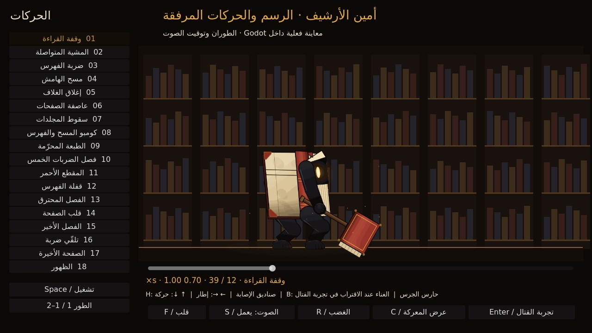

# LAST LECTURE — M26: أمين الأرشيف

رسم أمين الأرشيف وحركاته من الملفات المرفقة نفسها داخل **Godot 4.7.2**، مع استوديو لمراجعة الحركات ومواجهة مستقلة قابلة للعب. يصدر تسجيل الغناء من جسمه، ويقوى عند اقتراب البطل، ثم يتوقف فور بدء المواجهة.

**[تحميل مشروع Godot كاملًا — ZIP](https://github.com/thamrhntwl538-cell/-2d/archive/refs/heads/m26-archive-character.zip)** · [الصور والمعاينات](docs/M26_IMPORTED_PREVIEWS_AR.md) · [مراجعة المرجع](docs/M26_REFERENCE_AUDIT_AR.md)

## التشغيل

1. نزّل ZIP وفك الضغط، واحتفظ **بالمجلد كاملًا**.
2. في **Godot 4.7.2 Standard** اختر **Import** وافتح `project.godot` الموجود في جذر المجلد. انتظر اكتمال الاستيراد.
3. اضغط **F5** لفتح استوديو أمين الأرشيف، ثم **Enter** أو **A** في يد التحكم لدخول تجربة المواجهة.
4. اقترب من أمين الأرشيف لتسمع غناءه يعلو، ثم يبدأ القتال ويتوقف الغناء. **R** يعيد المحاولة، و**Esc** يعيدك إلى الاستوديو.

المشهد الافتراضي: `scenes/minibosses/archivist_reference_m26.tscn`. مشهد المواجهة: `scenes/minibosses/archivist_trial_m26.tscn`؛ يمكن فتحه مباشرة واستخدام **F6**.

## التحكم في المواجهة

| الفعل | الكيبورد | يد التحكم |
| --- | --- | --- |
| الحركة والتوجيه | A/D أو الأسهم، وW/S للتوجيه | العصا اليسرى أو D-pad |
| القفز | Space | A |
| ضربة السيف | J | X |
| الداش | K | RB |
| التقنية | L | B |
| العلاج بالضغط المطوّل | H | Y |
| الإيقاف والاستئناف | P | Start |
| إعادة المحاولة | R | Y أثناء الإيقاف أو بعد الموت أو الفوز |
| العودة إلى الاستوديو | Esc | Back |

أثناء القتال تبقى مؤشرات البطل أعلى اليسار؛ لا تغطي اليوميات والخريطة ونصوص الاستوديو ساحة المواجهة. البطل يظل بلا صوت بشري، وتبقى مؤثرات سيفه وحركته السابقة.

## استوديو الحركات

اختر الحركة من القائمة، أو استخدم **↑/↓** للتنقل بين الحركات، و**←/→** لمراجعة الإطارات. **1/2** يبدّل الطور، و**F** يعكس الاتجاه، و**Space** يوقف العرض، و**H** يظهر مستطيلات الإصابة المرجعية، و**S** يبدّل الصوت، و**R** يبدّل الغضب، و**C** يشغّل تسلسل العرض. هذه مفاتيح الاستوديو؛ **R داخل المواجهة يعيد المحاولة**.

في يد التحكم: **LB/RB** لاختيار الحركة، و**Y** لتبديل الطور، و**X** لعكس الاتجاه، و**Start** للإيقاف، و**A** لدخول المواجهة.

## ما تتضمنه النسخة

- **18 حركة، و 29 تسلسلًا بحسب الطور، و 1505 إطارات** من الصور المرفقة دون إعادة رسم أو تغيير بكسلات المصدر. استُكملت أطراف المؤثرات المقصوصة باستخدام دوال HTML الأصلية خارج الخلية فقط.
- ست هجمات في الطور الأول؛ يحتفظ الطور الثاني بها ويضيف ست هجمات، مع التحول إلى الطبعة المحرّمة. تظل مدد الحركات وأحداثها وسرعات المرجع محفوظة، بما فيها تسريع هجمات الطور الثاني إلى **1.15×** والغضب الأخير إلى **1.3× إضافية**.
- **43 مؤثرًا صوتيًا** من الحزمة المرفقة، مع جدولة الضربات والخطوات والجدران والنار. التحذيرات الموجودة في المرجع معتمدة وفق توضيح المستخدم الأخير.
- غناء مكاني من جسم أمين الأرشيف، يتوقف عند بدء القتال ولا يعود عند ابتعاد البطل؛ إعادة المحاولة تبدأ لقاءً جديدًا.

الرسم وتوقيت الحركات من المصدر. أما **صحة أمين الأرشيف البالغة 48 ، وسرعة مشيه 105 بكسلات/ثانية، وترتيب هجماته، والتحول عند نصف الصحة** فهي إعدادات ربط وتجربة داخل Godot، لأن HTML لا يحتوي مواجهة مكتملة أو ذكاءً قتاليًا. تتبع مناطق الضرر الفعلية المؤثرات المتحركة؛ مستطيلات المصدر الواسعة محفوظة للمراجعة. الغضب يبدأ تحت 15% من الصحة وفق وصف زر المرجع.

هذه **مواجهة مستقلة للاختبار**، ولم توضع بعد في خريطة الغرف الخمس عشرة. لا تمنح مكافأة دائمة ولا تكتب تقدمًا قتاليًا في حفظ المكتبة.

## المحتوى السابق

رسوم البطل وحارس الجرس ومصادر اللعب السابقة محفوظة. من الاستوديو اضغط **B** لفتح معاينة حارس الجرس، ثم **Enter/A** لتجربة مواجهته السابقة. مشهد المكتبة: `scenes/stage_01/folding_library_m24.tscn`.

[تفاصيل نقل الرسم والتحقق](docs/M26_IMPORTED_ART_AR.md) · [تفاصيل المواجهة](docs/M26_TRIAL_AR.md) · [الصوت](docs/M26_IMPORTED_AUDIO_QA_AR.md) · [الاختيارات المعتمدة](docs/M26_ACCEPTED_AR.md) · [ملف HTML المرفق](docs/reference/archivist_user_reference.html) · [اعتمادات الأصول](LICENSE_NOTES.txt)
