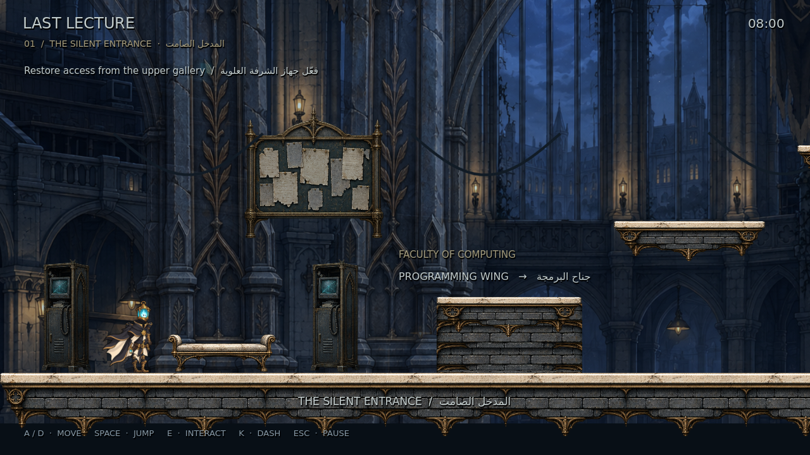
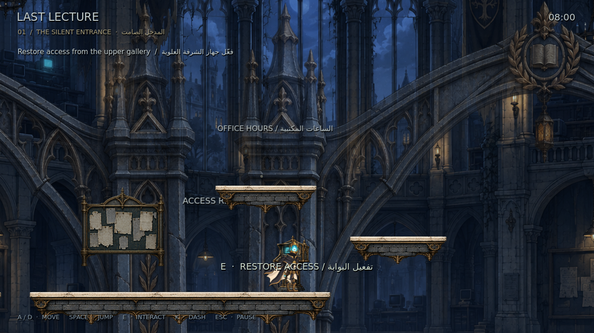

# LAST LECTURE — M14: The Silent Entrance

مدخل جناح البرمجة المنسي، قابل للعب داخل Godot: عمارة جامعية بطبقات مستقلة، شرفة علوية، جهاز يفتح البوابة، زاوية استكشاف اختيارية، ومقعد للحفظ. تصميم البطل وحركة M13 محفوظان.

**[تحميل المشروع كاملًا — M14 ZIP](https://github.com/thamrhntwl538-cell/-2d/archive/refs/tags/m14.zip)** · **[صفحة الإصدار](https://github.com/thamrhntwl538-cell/-2d/releases/tag/m14)** · **[فيديو من Godot](previews/m14/Silent_Entrance_Godot.mp4)**

## التشغيل

1. نزّل ZIP وفك الضغط. المجلد كامل مطلوب، وليس ملفًا منفردًا.
2. من Godot اختر **Import** وافتح `project.godot` داخل المجلد المستخرج.
3. اضغط **F5**. يفتح المدخل الجديد مباشرة.
4. الحركة A/D أو الأسهم، القفز Space، التفاعل E، الاندفاع K، والإيقاف Esc.

اصعد المنصات إلى جهاز الشرفة، ثم فعّله بـE وافتح البوابة. لا تحتاج إلى سلاح أو اندفاع لإكمال المسار. المقعد يحفظ التقدم، وقائمة الإيقاف تتيح إعادة البداية.

**نطاق M14:** الهوية الفنية والمدخل الأول، وفق Phase 1 وPhase 2 من الطلب. بقية الجناح والأعداء والزعيم مؤجّلة؛ صور الأعداء مرجع فقط. الرسومات الجديدة أول تمرير فني قابل للمراجعة، وليست اعتمادًا نهائيًا للإنتاج.

الاختبار الفعلي على **Godot 4.6.3 / OpenGL Compatibility**. يستهدف الوصف Godot 4.7؛ لم يتوفر هنا اختبار على 4.7.

## المعاينات والتوثيق

- [دليل الهوية الفنية](docs/ENVIRONMENT_ART_DIRECTION_AR.md)
- [التنفيذ وطريقة التجربة](docs/M14_IMPLEMENTATION_AR.md)
- [خريطة المدخل وخطة الجناح](docs/STAGE_01_MAP.md)
- [تقرير الاختبار](docs/M14_TEST_REPORT_AR.md) · [نتائج Godot التفصيلية](M14_ENVIRONMENT_QA.json)
- [المشاهد القابلة للتعديل](scenes/stage_01/)

نسخة حركة البطل السابقة: **[M13 ZIP](https://github.com/thamrhntwl538-cell/-2d/archive/refs/tags/m13.zip)** · [شرح M13](README_M13_AR.md). نموذج القتال السابق محفوظ في `scenes/main.tscn`، ويمكن فتحه وتشغيله بـF6 داخل المحرر.

مصادر الأصول والخطوط في [LICENSE_NOTES.txt](LICENSE_NOTES.txt).
