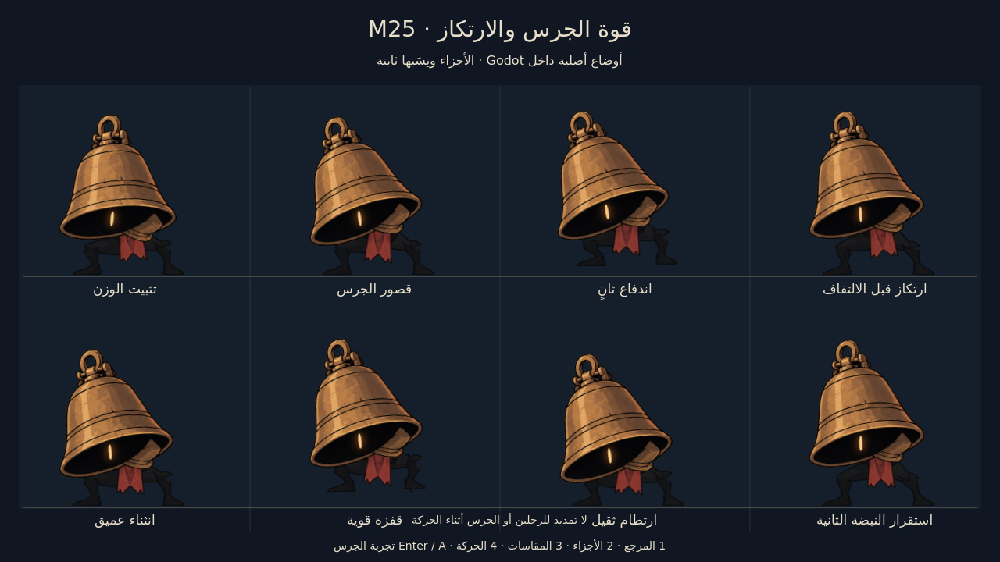

# LAST LECTURE — M25: صدى الجرس

ساحة حارس الجرس أصبحت **1080 بكسل بدل1500**. موجتا الهبوط تعبران إلى طرفيها بسرعة تتجاوز ركض البطل؛ البقاء بعيدًا أو عند الحافة لا يكفي، ويمكن القفز لتجاوزهما.

عند نصف الصحة يبدأ **طور ثانٍ فعلي**: اندفاعان سريعان مع انعطافة أرضية، وقفزة سحق أعلى وأسرع، ثم نبضة أرضية ثانية. حركات الجرس أثقل، مع قصاصات ورق وغبار وهزة قصيرة بعد الاصطدام. البطل بلا أصوات صوتية؛ صوت السيف والمؤثرات الجسدية محفوظة. أثناء القتال تبقى **مؤشرات البطل أعلى اليسار فقط**.

**[تحميل مشروع Godot كاملًا — M25 ZIP](https://github.com/thamrhntwl538-cell/-2d/archive/refs/heads/m25-bell-resonance.zip)** · [فيديو القتال من Godot](previews/m25/40_m25_native_demo.mp4) · [الفحوص](docs/M25_QA.md)

[وضوح الرجلين والجذع](previews/m25/11_body_readability.jpg) · [الشخصية](docs/M25_CHARACTER_AR.md) · [أثر الهبوط](docs/M25_ENVIRONMENT_AR.md) · [معرض العينات](docs/M25_PREVIEWS_AR.md)

## التشغيل

1. نزّل ZIP وفك الضغط، واحتفظ **بالمجلد كاملًا**.
2. افتح **Godot 4.7.2 Standard**، واختر **Import** ثم **`project.godot`** في جذر المجلد. انتظر استيراد الأصول.
3. اضغط **F5** لمعاينة الشخصية أولًا. الأرقام **1–4** تعرض المرجع والأجزاء والمقاسات والحركة؛ **Tab** للأجزاء، **Space** للتنفس، **G** للمفاصل.
4. اضغط **Enter** أو **A** للدخول إلى تجربة الجرس. استخدم **LB/RB** أو اتجاه اليمين واليسار للتنقل بين صفحات المعاينة.
5. تحرك يمينًا من الاستراحة إلى الساحة. **Esc/Start** للإيقاف؛ يمكن العودة إلى المكتبة من قائمة التجربة.

المشهد الافتراضي `scenes/minibosses/bell_character_review_m24.tscn`، والتجربة `scenes/minibosses/bell_trial_m24.tscn`، والمكتبة `scenes/stage_01/folding_library_m24.tscn`. أسماء المسارات محفوظة لتوافق الحفظ؛ محتواها في هذا الفرع M25. يمكن فتح أي مشهد واستخدام F6.

## الطوران والموجات

- **18 صحة إجمالية**: تسع لكل طور، دون إعادة تعبئة الصحة. عند عبور النصف يُكمل الحارس حركته ثم يتحول على الأرض. لا يمكن تخطي الطور الثاني بدفعة ضرر أثناء التحول.
- الطور الأول يحتفظ بالاندفاع والقفزة الثقيلة. موجاته بسرعة520بكسل/ثانية وتبقى حتى تصل للطرفين.
- الطور الثاني يضيف اندفاعين، كل منهما240بكسل خلال0.26ثانية، مع ارتكاز وانعطافة بينهما. القفزة أعلى وأسرع، وموجاتها بسرعة620بكسل/ثانية، ثم نبضة ثانية بعد0.96ثانية.
- تُكمل الموجات مسارها قبل بدء هجمة جسم جديدة. الهدف الملتقط للقفزة ثابت؛ لا تتعقب البطل في الهواء. الضربة الساقطة تنقص فانوسين، والموجة والاندفاع فانوسًا واحدًا.
- لا مؤشرات هجوم أو علامات أرضية أو أصوات تنبؤية. التعلم من حركة الجسم وإيقاع المواجهة.
- عند دخول المواجهة تختفي اليوميات والخريطة واللغة وعناوين المكان وتعليمات التحكم وشريط صحة الخصم. تبقى الصحة وطاقة الشعلة والعملات والتجهيزات ضمن المجموعة أعلى اليسار. الخريطة واليوميات متاحتان خارج القتال؛ **الإيقاف والإعدادات يظلان متاحين**.

الانتصار يمنح45عملة فعلية قابلة للجمع وتوسعة واحدة لسعة الفتائل. لا تتكرر المكافأة ولا تُحتسب هزيمة الزعيم الرئيسي. التجربة مستقلة عن حفظ المكتبة، وتبدأ بستة فوانيس صحة وطاقة99 وسعة4، مع السيف والداش والتقنية. الموت يعيدك إلى الاستراحة؛ قاعدة سقوط العملات تبقى فعالة.

## التحكم

| الفعل | الكيبورد | يد التحكم |
|---|---|---|
| الحركة واتجاه الضربة | A/D وW/S أو الأسهم | العصا اليسرى أوD-pad |
| قفز | Space | A |
| ضرب | J | X |
| داش | K | RB |
| شق الحبر | L | B |
| العلاج مع الثبات | الضغط المطول علىH | الضغط المطول علىY |
| التفاعل | E | LB |
| خريطة خارج القتال | M | Back |
| يوميات خارج القتال | N أوTab | L3 |
| إيقاف | Esc | Start |
| العربية والإنجليزية | F2 | من قائمة الواجهة |

يمكن تغيير ربط الكيبورد ويد التحكم من **الإيقاف ← التحكم**. المسمياتA/B/X/Yتصف توزيع يدXbox.

## ما بقي محفوظًا

رسم البطل وأطلس الجرس ونسبهما الأصلية محفوظة. حارس الجرس194بكسل مقابل104للبطل؛ لا تتمدد عظامه بين الأوضاع. رفع ثابت خفيف للدرجات السوداء يجعل الرجلين أوضح في الساحة.

المكتبة ذات المناطق الخمس عشرة واليوميات والألغاز وثلاثة أنواع الأعداء السابقة باقية. الصفحات والأدوات والمنصات والاستراحات خارج الساحة محفوظة. يمكن العودة من التجربة إلى المكتبة واستكمال الاستكشاف. الصحة ستة فوانيس، والطاقة مشتركة للعلاج والقدرات وتتجدد بضربات السيف. الفتائل تتبدل عند المقاعد، والقدرات الدائمة محفوظة عند الموت.

هذه النسخة تطور **حارس الجرس، الميني بوس الأول**. أمين الأرشيف وقاطع الهوامش وقارورة الحبر، ثم نائم الرفوف زعيم العالم الأول، لم تُضف معاركهم بعد. لم تُعد تجربة الغرف الخمس عشرة كلها لهذا التغيير المحدد.

الفيديو قتال آلي بإدخالات فعلية داخل Godot، مع الضرر والطاقة والمكافأة الحقيقية؛ صور الأوضاع معاينات تشكيل مضبوطة. الفحوص الآلية لا تمثل تقييم صعوبة أو متعة من لاعب بشري.

[نتائج الفحوص](docs/M25_QA.md) · [اعتمادات الأصول](LICENSE_NOTES.txt) · [ترخيص الصوت](assets/audio/m24/LICENSE.txt) · [ترخيص الموسيقى](assets/audio/m24/music/LICENSE.txt) · [نسخة M24 السابقة](https://github.com/thamrhntwl538-cell/-2d/tree/m24-bell-warden)
