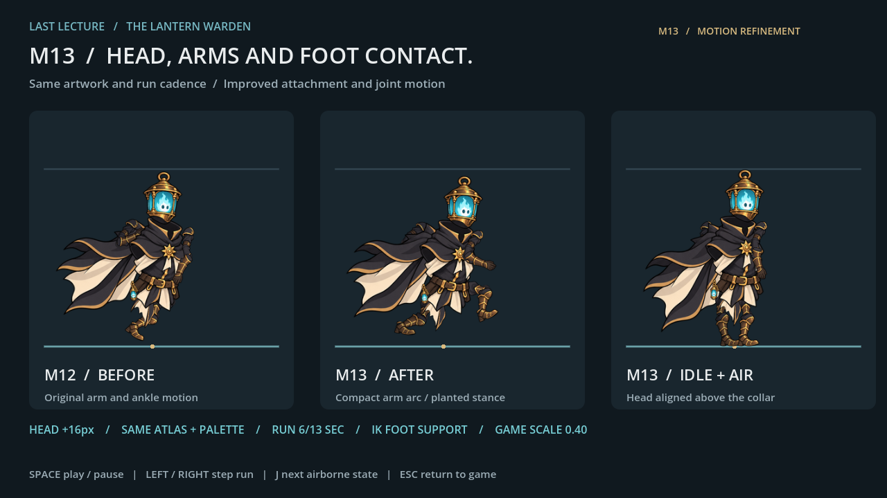

# LAST LECTURE — Lantern Warden M13

المشروع الكامل للعبة Godot. تعالج M13 موضع الرأس المتأخر، وانقلاب حركة الساعد، وارتكاز القدم أثناء الجري، مع الاحتفاظ بتصميم البطل وألوانه ومقاساته وإيقاع الجري الأصلي.

**[تحميل نسخة M13 كاملة ZIP](https://github.com/thamrhntwl538-cell/-2d/archive/refs/tags/m13.zip)** · **[صفحة الإصدار](https://github.com/thamrhntwl538-cell/-2d/releases/tag/m13)**

## التجربة

1. نزّل ZIP وفك الضغط.
2. افتح Godot 4.6 أو أحدث، واختر Import، ثم افتح `project.godot` داخل المجلد المستخرج.
3. اضغط F5 لتشغيل اللعبة. الحركة A/D، والقفز Space.
4. للمقارنة قبل/بعد: افتح `scenes/warden_m13_review.tscn` واضغط F6.

يمكن تنزيل أحدث نسخة أيضًا من Code → Download ZIP. المجلد كامل مطلوب لتشغيل المشروع.

## تغييرات M13

- تقدم اتصال الفانوس فوق مقدمة الياقة، مع بقاء حجمه ووجهه كما هما.
- مسار أصغر ومتصل لليد، ووضع الذراع البعيد خلف العباءة.
- دعم واضح للقدم على الأرض، ورفع للكاحل، وتوافق توقيت الخطوات مع سرعة اللاعب.
- 107 إطارات من مصدر الرسم نفسه، مع بقاء دورة الجري `6/13` ثانية والمقياس 0.40.
- ثبات مصدر الرسم والألوان وأطوال الجسم. Slash ورسوم القتال السابقة مؤجّلة كما في M12.

## التوثيق والمعاينة

- [شرح التصحيحات والقياسات](README_M13_AR.md)
- [فيديو المقارنة والاختبار](previews/Warden_M13_Preview.mp4)
- [نتيجة اختبار اللعب](WARDEN_M13_GAMEPLAY_QA.json)
- [قياسات الحركة والارتكاز](WARDEN_M13_ASSET_QA.json)
- [تقرير التسليم](WARDEN_M13_DELIVERY_QA.json)

أُجري الاختبار في Godot 4.6.3 / OpenGL Compatibility / llvmpipe. أصول M12 والمراحل السابقة محفوظة، وتتوفر [نسخة M12 السابقة](https://github.com/thamrhntwl538-cell/-2d/releases/tag/m12).

تفاصيل المصادر في [LICENSE_NOTES.txt](LICENSE_NOTES.txt).
