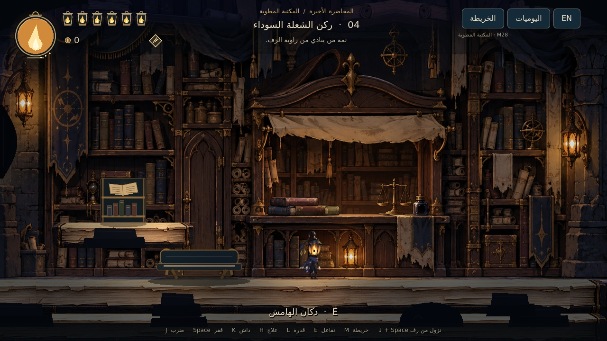

# LAST LECTURE — M28: المكتبة وغرف الحراس

العالم ذو **15 منطقة** أصبح نقطة التشغيل الرئيسية، مع مسارات قفز وداش جديدة، وألغاز أرضية، وسوق يستخدم العملات، وباب يقود من الأرشيف إلى مواجهة أمين الأرشيف المعتمدة. حارس الجرس باقٍ في مشغل التجليد، ورسوم البطل والخصوم المعتمدة محفوظة.

**[تحميل مشروع Godot كاملًا — M28 ZIP](https://github.com/thamrhntwl538-cell/-2d/archive/refs/heads/m28-integrated-world.zip)** · [صور وفيديو داخل Godot](docs/M28_PREVIEWS_AR.md) · [دليل البيئة والمناطق](docs/M28_ENVIRONMENT_AR.md)

## التشغيل والتجربة السريعة

1. نزّل ZIP وفك الضغط، واحتفظ **بالمجلد كاملًا**.
2. في **Godot 4.7.2 Standard** اختر **Import** وافتح `project.godot` في جذر المجلد. انتظر اكتمال الاستيراد، ثم اضغط **F5** لتبدأ من المكتبة.
3. لتجربة أمين الأرشيف مباشرة: افتح `scenes/minibosses/archivist_trial_m26.tscn` واضغط **F6**. هذه التجربة المستقلة لا تمنح مكافآت للعالم؛ **P / Start** يوقفها و**Esc / Back** يعيد إلى الاستوديو.
4. داخل العالم، تصل إلى خزنة الأمين عبر بابها في **المنطقة 06**. **E** يفتح الباب؛ يوجد مقعد على رف قريب منه. تسمع غناءه من موضعه داخل القاعة، ويتوقف مع بدء المواجهة.
5. يتيح الإيقاف **Esc / Start** فتح استوديو الشخصيات والتجارب والرجوع إلى المكتبة. مواجهة حارس الجرس الفعلية في **المنطقة 12**.

تبقى أسماء ملفات مواجهة الأمين برقم M26 حفاظًا على الربط؛ نسخة المشروع الحالية M28. المشهد الافتراضي هو `scenes/stage_01/folding_library_m28.tscn`.

## البيئة والاستكشاف

- **11 مسار تحقق جديدًا**: عتبات كتب صلبة، وثلاث فجوات رفوف بعرض 300 بكسل، وعبور فوهات حبر دورية، ومسارات ألواح وأختام وعودة. الأرض أسفل فجوات الرفوف تتيح التعافي من السقوط.
- لوح في منطقة الإخراج يثبت جسر العودة. لغز الأختام في غرفة الأثقال يتطلب ملاحظة ترتيب **I، III، II**، ويفتح درجات عودة ومكافأة.
- ألواح البيئة ولغز الأختام تمنح **51 عملة إجمالًا** عبر إيصالات دائمة؛ إعادة دخول الغرفة لا تكرر المكافأة.
- رسم جديد للسوق، ومدخل خاص لخزنة الأمين، ومدخل لمشغل الجرس، مع طبقات قريبة من الكتب والرقوق وإنارة محدودة. تبقى صفحات القراءة في أركانها المخصصة.
- النزول من رف أحادي الاتجاه باستخدام **أسفل + قفز**؛ يتوقف الداش عند اصطدامه بجدار صلب. ارتفاعات القفز وتوقيته وسرعة الركض وتوقيت السيف المعتمدة محفوظة.

## السوق والعملات والحفظ

في **المنطقة 04 — ركن الشعلة السوداء** يوجد **دكان الهامش**. اقترب واضغط **E** أو زر التفاعل المعين. الخريطة الأساسية متاحة دون شراء.

| المشتريات | السعر | الأثر الفعلي |
| --- | ---: | --- |
| أطلس الممرات | 24 | يعلّم الاستراحات والسوق وغرف الحراس في المناطق المكتشفة |
| إبرة الفهرس | 32 | تشير إلى صفحة قريبة غير مقروءة؛ تختفي أثناء القتال والقراءة |
| حلقة فتيل إضافية | 70 | تزيد السعة بموضع واحد، مرة واحدة |
| فتيل الاستمداد | 40 | يزيد الوهج المكتسب عند تجهيزه |
| فتيل السكينة | 65 | يقلل زمن العلاج عند تجهيزه |

الفتيل الموجود أصلًا ضمن مقتنياتك يُعرض كمملوك ولا تُخصم قيمته. التجهيز والتبديل عند المقاعد فقط. المشتريات والقدرات تبقى بعد الموت، والعملات المحمولة تسقط وفق القاعدة المعتمدة.

أمين الأرشيف يمنح بعد انتصار فعلي **توسعة سعة واحدة و60 عملة قابلة للجمع أمام الخزنة**؛ حارس الجرس يحتفظ بتوسعته و45 عملة. لا يمكن تكرار المكافآت عبر العودة أو إعادة تحميل الحفظ. خسائر العملات داخل الخزنة تبقى عند موضع الموت داخلها، ويمكن استعادتها بالتفاعل بعد العودة.

حفظ M28 مستقل في `user://folding_library_m28.json`. عند وجود حفظ استكشاف أقدم صالح، تُنسخ حالته مرة واحدة دون تعديل ملفه الأصلي. العودة من الخزنة أو الاستوديو تحفظ الصحة والطاقة، والموت يعيد البطل إلى آخر مقعد. [تفاصيل الربط والحفظ](docs/M28_JOURNEY_AR.md)

## التحكم والعلاج والصوت

| الفعل | الكيبورد | يد التحكم الافتراضية |
| --- | --- | --- |
| الحركة / التوجيه | A/D والأسهم | العصا اليسرى / D-pad |
| القفز | Space | A |
| النزول من رف | أسفل + Space | أسفل + A |
| السيف | J | X |
| الداش | K | RB |
| التقنية | L | B |
| العلاج | الضغط المطوّل على H | الضغط المطوّل على Y |
| التفاعل | E | LB |
| الخريطة / اليوميات | M / N | Back / ضغط العصا اليسرى |
| الإيقاف | Esc | Start |
| تبديل اللغة | F2 | من الواجهة |

العلاج يحتاج **33 طاقة** وصحة ناقصة وثباتًا لنحو **1.15 ثانية**. أصلح M28 عرض حلقة تقدمه في مواجهة الأمين، مع تلميح صغير قرب مؤشرات البطل للطاقة أو الحركة أو إفلات الزر بعد مقاطعة الإصابة. الإصابة تقطع العلاج؛ لا يمنح الضغط المستمر صحة مجانية. [فحص العلاج بالمدخلات الفعلية](docs/M28_FOCUS_AR.md)

توجد ستة أصوات خطوات أصلية أهدأ للحجر والورق. لا خطوات أثناء الوقوف أو الهواء أو الإيقاف؛ تبقى مؤثرات السيف والقتال، والبطل بلا صوت بشري. [فحص الصوت](docs/M28_AUDIO_AR.md)

## التحقق وحدود هذه النسخة

راجع [نتائج M28](docs/M28_QA_AR.md) و[فحص المسارات](docs/M28_ROUTES_AR.md). تشمل الاختبارات بداية فعلية حتى المنطقة الثانية، وتركيب الغرف الخمس عشرة واصطداماتها، والمسارات الجديدة، والمتجر، وحفظ مكافآت المواجهات والموت، والعلاج والأصوات. بدايات المناطق المتقدمة في فحوص الهندسة مواضع اختبار مهيأة؛ ليست ادعاء إنهاء بشري للمرحلة كاملة أو توازن نهائي للصعوبة.

المواجهتان المكتملتان في العالم هما **حارس الجرس وأمين الأرشيف**. **قاطع الهوامش وقارورة الحبر ونائم الرفوف** لم تكتمل مواجهاتهم؛ المنطقة 14 محجوزة للزعيم المعتمد، والمنطقة 15 قابلة للاستكشاف وعتبة العالم التالي مغلقة. لا تسجل النسخة فوزًا وهميًا عليهم أو تنقلك إلى بعد غير موجود.

[تفاصيل الرسم الأصلي للأمين](docs/M26_IMPORTED_ART_AR.md) · [المتجر](docs/M28_SHOP_AR.md) · [الحركة](docs/M28_MOVEMENT_AR.md) · [اعتمادات الأصول](LICENSE_NOTES.txt) · [نسخة M27 السابقة](https://github.com/thamrhntwl538-cell/-2d/tree/m27-archivist-combat)
