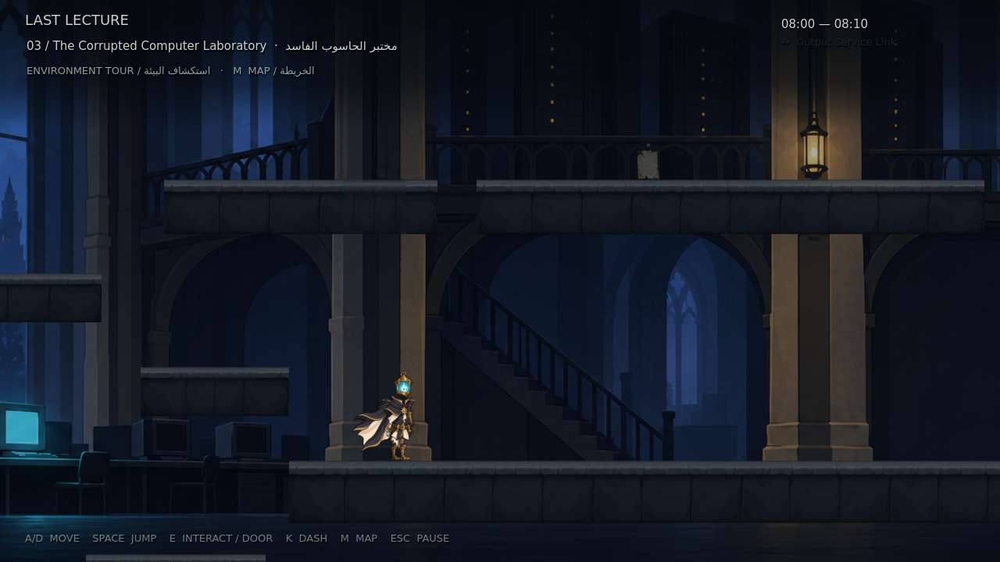

# LAST LECTURE — M16: The Forgotten Programming Wing

تنقيح بصري للغرف العشر المترابطة: رسم أنعم، زخارف أقل، مساحات أهدأ، وظلال داكنة مع بقع ضوء محدودة. تصميم البطل وحركة **M13** محفوظان، مع مسارات الاستكشاف والمصعد ولغز INPUT → PROCESS → OUTPUT.

**[تحميل المشروع كاملًا — M16 ZIP](https://github.com/thamrhntwl538-cell/-2d/archive/refs/tags/m16.zip)** · **[صفحة الإصدار](https://github.com/thamrhntwl538-cell/-2d/releases/tag/m16)** · **[فيديو البيئة داخل Godot](previews/m16/Forgotten_Wing_Polished_Godot.mp4)**

## التشغيل

1. نزّل ZIP وفك الضغط، واحتفظ بالمجلد كاملًا.
2. من Godot اختر **Import** وافتح **`project.godot`** داخل مجلد **`-2d-m16`**.
3. اضغط **F5** لتشغيل جولة البيئة.

**A/D** أو الأسهم للحركة، **Space** للقفز، **E** للتفاعل وعبور الأبواب، **K** للاندفاع، **M** للخريطة، و**Esc** للإيقاف. يمكن إكمال مسار البيئة بالقفز والحركة العاديين دون سلاح أو اندفاع.

اصعد إلى جهاز شرفة المدخل لتفتح البوابة. في الأرشيف، قف على المصعد واضغط E للانتقال إلى الطابق التالي، أو اطلبه من جهاز الشرفة. فعّل **INPUT ثم PROCESS ثم OUTPUT** لفتح الطريق والاختصار. المقاعد تحفظ التقدم، وقائمة الإيقاف تتيح إعادة البداية.

يُنقل حفظ M15 تلقائيًا مرة واحدة عند تشغيل M16. يستخدم المشروع اسم تطبيق ثابتًا لاستمرار الحفظ بين التحديثات.

## تغييرات M16

- **سبع خلفيات جديدة** تمنح المدخل والردهة والمختبر والأرشيف والآلات والخزنة وقاعة المحاكمة هوية أوضح، مع ألوان هادئة ومساحات مفتوحة حول اللعب.
- **26 عنصر زينة بدلًا من 53**، وإزالة الأقواس الذهبية المتكررة والزخارف القريبة من الكاميرا.
- **65 سطحًا ومنصة** بمظهر حجر بسيط وحواف مقروءة، مع الحفاظ على هندسة المسار والتصادم.
- إضاءة موضعية محدودة، بحد أقصى **ثلاثة مصادر للبيئة إضافة إلى فانوس البطل**، وغبار وأوراق وكابلات أقل.

الأصول الجديدة مولدة خصيصًا للمشروع ومركبة في طبقات وقطع قابلة للتعديل. هذا تنقيح فني قابل للمراجعة. لم تُنسخ أصول أو أصوات من Hollow Knight.

## نطاق النسخة والاختبار

النسخة تغطي **جولة البيئة قبل تنفيذ الأعداء والزعيم وSlash**. يتيح وضع المعاينة زيارة قاعات القتال المستقبلية؛ يظل تقدم المواجهات ومفتاح الزعيم والانتصار مستقلًا عن جولة الاستكشاف. أبواب اللغز والاختصارات تتطلب تفاعلاتها الفعلية.

المحرك المستخدم فعليًا هو **Godot 4.6.3**. لم يُختبر Godot 4.7 هنا. الاختبارات وحدودها موثقة في [تقرير M16](docs/M16_TEST_REPORT_AR.md).

[خريطة الغرف والاختصارات](docs/M15_STAGE_MAP.md) · [الإصدار السابق M15](https://github.com/thamrhntwl538-cell/-2d/releases/tag/m15) · [حركة البطل M13](https://github.com/thamrhntwl538-cell/-2d/releases/tag/m13)

مصادر الأصول والخطوط في [LICENSE_NOTES.txt](LICENSE_NOTES.txt).
