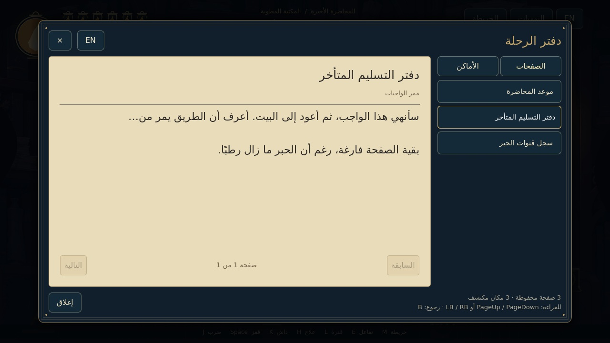

# LAST LECTURE — M22: المكتبة واليوميات والمواجهات

مشروع **Godot 4.7.2 Standard** كامل، يفتح مباشرة من `project.godot`. تمتد البيئة الورقية القريبة والإضاءة المحلية إلى المناطق الخمس عشرة، مع صفحات محفوظة على رفوف ومكاتب قراءة، وتحديات عبور إضافية، ولغز مصابيح اختياري، وثلاثة أنواع أعداء قابلة للقتال.

**[تحميل المشروع كاملًا — M22 ZIP](https://github.com/thamrhntwl538-cell/-2d/archive/refs/heads/m22-library-expansion.zip)** · [التحقق والحدود](docs/M22_QA.md) · [البيئة والمسارات](docs/M22_ENVIRONMENT_AR.md) · [لغز المصابيح](docs/M22_PUZZLES_AR.md)

## التشغيل

1. نزّل ZIP وفك الضغط، واحتفظ بالمجلد كاملًا.
2. افتح **Godot 4.7.2 Standard** واختر **Import** ثم **`project.godot`** في جذر المجلد الناتج.
3. انتظر استيراد الرسوم، ثم اضغط **F5**. البداية `scenes/stage_01/folding_library_m22.tscn`.

تستمر ملفات حفظ M18–M21 والفتائل والقدرات والألغاز والانتصارات. لبدء تجربة جديدة استخدم قائمة الإيقاف ثم أكد البداية الجديدة. لا تمسح النسخة بيانات الحفظ تلقائيًا.

## الجديد

- يوميات بفهرس للصفحات المجموعة والمناطق المكتشفة، ومصدر لكل صفحة، وقراءة عربية وإنجليزية، وتقليب صفحات وحركة فتح وإغلاق. يبقى اللعب متوقفًا إلى اكتمال الإغلاق. استخدم PageUp/PageDown أو LB/RB للصفحات والتمرير أثناء القراءة.
- أماكن قراءة مخصصة، وصفحات فوق حوامل أو داخل رفوف ومكاتب، مع شرفات ومسارات جانبية وسواتر فعلية. المصابيح والفانوس يضيئان المحيط، ولا تؤثر إضاءة العالم على الواجهة.
- لغز **السطور الغائبة** في المنطقة05: راقب الرسم، ثم تحرك بين المصابيح المنقوشة في الرفوف. الخطأ يتيح إعادة المحاولة دون خسارة؛ الحل يكشف ورقة ويمنح15عملة مرة واحدة.
- **يرقة الخلل** في02، و**شبح النافذة** على شرفة اختيارية في03 ثم06، و**برج الصياغة** في معرض اختياري في08 ثم11. للشبح هبوط على موقع سابق واضح، وللبرج تحذير ورشقة وتلقيم؛ السواتر الصلبة تحجب طلقاته. القراءة والاستراحات ومداخل الغرف محمية من هجمات العدوين الجديدين.
- انتقالات مع اسم المنطقة، ومهلة وصول تمنع بدء هجوم جديد فور الدخول. هزائم المواجهات المحددة تحفظ، ولا تتكرر مكافأة القتل من تبليغ مكرر.

**رسم البطل هو أطلس M20 نفسه** بالنسب والألوان والحركة المعتمدة؛ العينان داخل الشعلة هما إضافة M21 الوحيدة. لم يُبسّط البطل. [إثبات أصل الرسم ومعرض التعبيرات](docs/M21_HERO_EYES_AR.md). افتح `scenes/warden_m21_review.tscn` في المحرر واضغط F6 لمعرض الرسم، وF5 لتجربة اللعب.

## التحكم

| الفعل | الكيبورد | يد التحكم |
|---|---|---|
| الحركة واتجاه الضربة | A/D وW/S أو الأسهم | العصا اليسرى أوD-pad |
| قفز | Space | A |
| ضرب | J | X |
| داش | K | RB |
| شق الحبر | L | B |
| العلاج مع الثبات | الضغط المطول علىH | الضغط المطول علىY |
| التفاعل | E | LB |
| خريطة | M | Back |
| يوميات | N أوTab | L3 |
| إيقاف | Esc | Start |
| العربية والإنجليزية | F2 | من قائمة الواجهة |

يمكن تغيير ربط الأزرار من **الإيقاف ← التحكم**؛ يحفظ ربط الكيبورد ويد التحكم كلًا على حدة. المسمياتA/B/X/Yتصف توزيع يدXbox، وتختلف الكتابة المطبوعة على أيدي أخرى.

## العملات والصحة والطاقة

[تفاصيل العملات والواجهة والتحقق](docs/M22_CURRENCY_AND_HUD_AR.md).

تسقط عملات فعلية من الأعداء، وتظهر مكافآت الألغاز وفتح الممرات بعد إنجازها. اقترب لتنجذب العملات وتدخل رصيدك؛ لا يضاف مبلغ القتل قبل جمعها. العملات التي لم تجمعها تبقى محفوظة في منطقتها، ولا تعاد مكافأة مصدر مكتمل. السوق ومهام الشخصيات يأتيان لاحقًا؛ يستخدمان الرصيد ومسار المكافأة نفسه.

الصحة ستة فوانيس صغيرة تنطفئ نارها عند الضرر وتعود بالعلاج. الدائرة الكبيرة هي طاقة العلاج والقدرات المشتركة؛ تمتلئ بإصابة السيف. لا تجدد مجانيًا، ولا تمثل عددًا منفصلًا من شحنات العلاج.

## تجربة البداية

اجمع أداة الحارس والداش في01، ويمكن جمع الفتيل وتجهيزه عند المقعد. اقرأ الصفحة فوق رفها الجانبي، ثم اعبر إلى02. راقب تحذير اليرقة، تفاد اندفاعها واضرب خلال التعافي؛ ثلاث ضربات تكفي. الانتصار الحقيقي يفتح03 ويتيح جمع شق الحبر. المواجهتان الجديدتان في شرفات جانبية، وليستا حاجزين أمام القراءة أو الألغاز الأساسية.

الطريق الأساسي يحتفظ بتوصيل الحبر ثم جمع الكتب وترتيبها ثم موازنة الجسر، وبالممرات المختصرة المعتمدة. الأرشيف يحتفظ بالصعود متعدد المستويات. يمكن استكشاف05 من ركن الشعلة السوداء لتجربة لغز المصابيح.

ستة فوانيس صحة بداخلها نار، ودائرة طاقة كبيرة بمخزون مشترك99. السيف يجدد الطاقة؛ العلاج والقدرة يستهلكانها. الفتائل تبدل عند المقاعد فقط. عند الموت تبقى القدرات والتجهيزات والألغاز والانتصارات، وتسقط العملة للاستعادة؛ الموت مرة أخرى يمحو الكومة السابقة. [تفاصيل القتال والفتائل المعتمدة](docs/M18_COMBAT_SPEC_AR.md).

## نطاق النسخة

المناطق الخمس عشرة قابلة للاستكشاف في **معاينة البيئة**، مع الألغاز وثلاثة أنواع أعداء فعلية. الحارس ود. كومبايلر وبقية أنواع الأعداء لم تُنفذ معاركهم بعد؛ الوصول إلى ساحاتهم في المعاينة لا يمنح ختمًا أو انتصارًا مزيفًا. العالم الثاني لم يُضف بعد، ونهاية المعاينة منفصلة عن المغادرة الحقيقية.

[صور M22 من المحرك](previews/m22) · [شبح النافذة](docs/M22_POPUP_WRAITH_AR.md) · [برج الصياغة](docs/M22_SYNTAX_TURRET_AR.md) · [الإضاءة والعيون في M21](docs/M21_QA.md) · [نسخة M21 السابقة](https://github.com/thamrhntwl538-cell/-2d/tree/m21-paper-shadows) · [اعتمادات الأصول](LICENSE_NOTES.txt)
