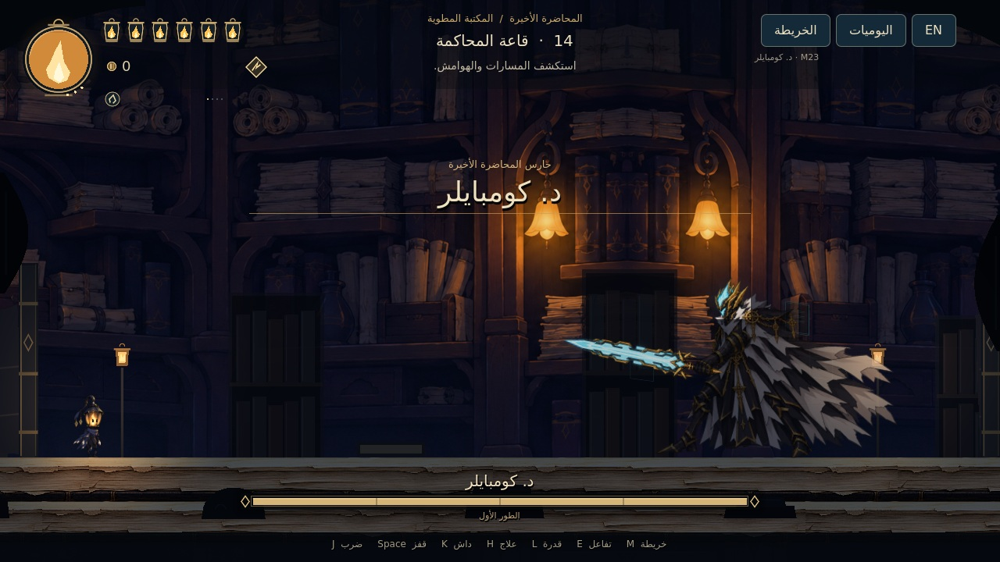

# LAST LECTURE — M23: د. كومبايلر

مشروع **Godot 4.7.2 Standard** كامل. يبدأ F5 الآن أمام ساحة **د. كومبايلر** لتجربة معركة فعلية بطورين، مع موسيقى أصلية لكل طور وتحذيرات عربية وإنجليزية. تبقى المكتبة ذات المناطق الخمس عشرة واليوميات والألغاز وثلاثة الأعداء السابقين متاحة من قائمة الإيقاف.

**[تحميل المشروع كاملًا — M23 ZIP](https://github.com/thamrhntwl538-cell/-2d/archive/refs/heads/m23-compiler-boss.zip)** · [تجربة القتال والتحقق](docs/M23_QA.md) · [الرسم](docs/M23_COMPILER_ART_AR.md) · [الموسيقى](docs/M23_MUSIC_AR.md)

[شاهد ضربة البطل والتحول مع الأصوات والموسيقى — 20.5 ثانية](previews/m23/40_compiler_and_ember_strike.mp4) · [مراجعة تناسب الذراعين](previews/m23/09_compiler_arms_review.jpg)

## التشغيل

1. نزّل ZIP وفك الضغط. احتفظ بمجلد **`-2d-m23-compiler-boss` كاملًا**، بما فيه `assets` و`scripts` و`scenes`.
2. افتح **Godot 4.7.2 Standard**، واختر **Import** ثم **`project.godot`** في جذر المجلد.
3. انتظر استيراد الأصول، ثم اضغط **F5**. البداية `scenes/bosses/compiler_trial_m23.tscn` أمام المقعد؛ تحرك يمينًا لدخول الساحة.
4. من **Esc ← العودة من تجربة الزعيم** انتقل إلى المكتبة وتقدمك السابق. يمكنك العودة للتجربة من قائمة المكتبة. لفتح المكتبة مباشرة في المحرر افتح `scenes/stage_01/folding_library_m23.tscn` واضغط **F6**.

تجربة الزعيم مستقلة: ستة فوانيس صحة، طاقة99، السيف والداش وشق الحبر، وسعة تجهيز4. كل دخول جديد يبدأ محاولة جديدة. تحفظ نتائج التجربة في ملف مستقل، ولا تستبدل العملات أو التجهيزات أو مقعد الاستراحة في حفظ المكتبة. الموت داخل المحاولة يعيدك بسرعة إلى المقعد الآمن خارج الساحة؛ تبقى قاعدة سقوط العملة عند الموت فعالة. يمكن إعادة المواجهة من قائمة الإيقاف.

## معركة د. كومبايلر

- رسم جانبي مائل باتجاه البطل، مع ذراع وسيف مرتبطين عند القبضة. يلتفت أثناء الانتظار والتعافي، ويثبت اتجاه الهجمة بعد التحذير.
- **48 صحة وطوران**؛ يبدأ الثاني عند نصف الصحة. شيفرات مقذوفة، وضربة تنفيذ أرضية ثقيلة، وأعمدة بعلامات أرضية ثابتة، ثم سلاسل منخفضة تتجاوزها بالقفز. لكل نمط تحذير ووقت محدد للرد.
- الضربة الثقيلة تنقص فانوسين. الجسم نفسه آمن للمس، ولا تتعطل الهجمات بمجرد تكرار الضرب. يمكن صد طرف السيف بتوقيت مناسب. الإيقاف يجمد الهجمات القائمة ويستأنفها كما كانت.
- موسيقى أصلية أوركسترالية تتبدل بين الطورين بتداخل سلس، وتخف أثناء التحذيرات والإيقاف. للتحول حركة مدتها ثانيتان مع انحناء وتوهج ورفع للسيف وعودة للاستعداد؛ ترافقها استجابة صوتية خاصة، مع خاتمة للانتصار. يمكن كتم موسيقى الزعيم من القائمة.
- الانتصار الفعلي يمنح **90عملة قابلة للجمع** و**زيادة واحدة لسعة الفتائل**، ويفتح أبواب الساحة. نتائج التجربة تبقى في حفظ التجربة. انتصار المكتبة في معاينة البيئة يحفظ بعلم منفصل عن تقدم القصة.

**البطل هو رسم M20 نفسه دون تغيير البكسلات أو النسب أو الألوان**؛ العينان داخل الشعلة هما إضافة M21. [توثيق رسم البطل](docs/M21_HERO_EYES_AR.md).

## ضربة البطل القصيرة

السيف صغير وأثره هلال قصير بلون الشعلة البرتقالي. تدفع الحركة الكتف والجسم بصريًا إلى الأمام ثم تعود للاستعداد، مع بقاء حرية الحركة والقفز والداش. مدى الإصابة يتبع الرسم القصير فعليًا، بما في ذلك الضربة العلوية والسفلية وفتيل المدى؛ لا يمتد ضرر خفي إلى أثر الضربة القديم. تبقى رسومات البطل ونسبه وعيناه وحركتا الجري والقفز المعتمدتان كما هي.

[تفاصيل ضربة البطل وفحصها](docs/M23_HERO_STRIKE_AR.md)

## الأصوات

أصوات أصلية مميزة للبطل والبوس، وضربات الشعلة والإصابة والصد والهبوط، وخطوات على الورق والحجر، وفتح الكتب وتقليب الصفحات والعملات والمقاعد والألغاز، ولمسات ورقية وسلاسل ومصابيح في البيئة. ترتبط الأصوات بالفعل الحقيقي، وتمنع فترات قصيرة تكدس الأصوات المتكررة. يحفظ الإيقاف موضع صوت التحول ويستأنفه مع الحركة؛ يبقى صوت الصفحة متاحًا أثناء القراءة.

[تصميم الأصوات ومصادرها](docs/M23_CHARACTER_AUDIO_AR.md) · [الربط والمزج والتحقق](docs/M23_SOUNDSCAPE_AR.md)

## البيئة والمحتوى السابق

البيئة الورقية القريبة والإضاءة المحلية تشمل المناطق الخمس عشرة. الصفحات مرتبة على رفوف ومكاتب قراءة، مع شرفات ومسارات جانبية وسواتر فعلية، ويوميات بفهرس للصفحات والمناطق ومصدر لكل ورقة، وقراءة عربية وإنجليزية وحركة فتح وإغلاق وتقليب.

يرقة الخلل وشبح النافذة وبرج الصياغة قابلة للقتال. يبقى لغز **السطور الغائبة** في المنطقة05، ومكافأته15عملة مرة واحدة، وتوصيل الحبر وجمع الكتب وترتيبها وموازنة الجسر والمسارات المختصرة المعتمدة.

[صور المكتبة](previews/m22) · [البيئة والمسارات](docs/M22_ENVIRONMENT_AR.md) · [لغز المصابيح](docs/M22_PUZZLES_AR.md) · [اليوميات والتحقق السابق](docs/M22_QA.md)

## التحكم

| الفعل | الكيبورد | يد التحكم |
|---|---|---|
| الحركة واتجاه الضربة | A/D وW/S أو الأسهم | العصا اليسرى أوD-pad |
| قفز | Space | A |
| ضرب | J | X |
| داش | K | RB |
| شق الحبر | L | B |
| العلاج مع الثبات | الضغط المطول علىH | الضغط المطول علىY |
| التفاعل | E | LB |
| خريطة | M | Back |
| يوميات | N أوTab | L3 |
| إيقاف | Esc | Start |
| العربية والإنجليزية | F2 | من قائمة الواجهة |

يمكن تغيير ربط الأزرار من **الإيقاف ← التحكم**؛ يحفظ ربط الكيبورد ويد التحكم كلًا على حدة. المسمياتA/B/X/Yتصف توزيع يدXbox، وتختلف الكتابة المطبوعة على أيدي أخرى.

## العملات والصحة والطاقة

[تفاصيل العملات والواجهة والتحقق](docs/M22_CURRENCY_AND_HUD_AR.md).

تسقط عملات فعلية من الأعداء، وتظهر مكافآت الألغاز وفتح الممرات بعد إنجازها. اقترب لتنجذب العملات وتدخل رصيدك؛ لا يضاف مبلغ القتل قبل جمعها. العملات التي لم تجمعها تبقى محفوظة في منطقتها، ولا تعاد مكافأة مصدر مكتمل. السوق ومهام الشخصيات يأتيان لاحقًا؛ يستخدمان الرصيد ومسار المكافأة نفسه.

الصحة ستة فوانيس صغيرة تنطفئ نارها عند الضرر وتعود بالعلاج. الدائرة الكبيرة هي طاقة العلاج والقدرات المشتركة؛ تمتلئ بإصابة السيف. لا تجدد مجانيًا، ولا تمثل عددًا منفصلًا من شحنات العلاج.

## استكشاف المكتبة بعد العودة من التجربة

اجمع أداة الحارس والداش في01، ويمكن جمع الفتيل وتجهيزه عند المقعد. اقرأ الصفحة فوق رفها الجانبي، ثم اعبر إلى02. راقب تحذير اليرقة، تفاد اندفاعها واضرب خلال التعافي؛ ثلاث ضربات تكفي. الانتصار الحقيقي يفتح03 ويتيح جمع شق الحبر. المواجهتان الجديدتان في شرفات جانبية، وليستا حاجزين أمام القراءة أو الألغاز الأساسية.

الطريق الأساسي يحتفظ بتوصيل الحبر ثم جمع الكتب وترتيبها ثم موازنة الجسر، وبالممرات المختصرة المعتمدة. الأرشيف يحتفظ بالصعود متعدد المستويات. يمكن استكشاف05 من ركن الشعلة السوداء لتجربة لغز المصابيح.

ستة فوانيس صحة بداخلها نار، ودائرة طاقة كبيرة بمخزون مشترك99. السيف يجدد الطاقة؛ العلاج والقدرة يستهلكانها. الفتائل تبدل عند المقاعد فقط. عند الموت تبقى القدرات والتجهيزات والألغاز والانتصارات، وتسقط العملة للاستعادة؛ الموت مرة أخرى يمحو الكومة السابقة. [تفاصيل القتال والفتائل المعتمدة](docs/M18_COMBAT_SPEC_AR.md).

## نطاق النسخة

د. كومبايلر معركة فعلية الآن، متاحة مباشرة كتجربة مستقلة وفي المنطقة14 من معاينة المكتبة. الحارس وبقية أنواع الأعداء والعالم الثاني لم تُنفّذ بعد؛ لا تمنح تجربة الزعيم ختم الحارس أو أهلية قصة وهمية. دمج الزعيم موجود أيضًا للمسار القصصي، لكنه يحترم شروط الحارس والختم بدل تجاوزها. مغادرة العالم الأول الحقيقية لا تُعرض بوصفها مكتملة في هذه المعاينة.

الصور `05_compiler_facing_left` و`06_compiler_facing_right` و`07_compiler_weapon_grip` مراجعات عرض مضبوطة داخل المحرك، لا تمثل اجتياز قتال كامل. صور `01_compiler_intro` و`02_compiler_code_warning` من تشغيل الدخول والتحذير الفعليين. صور الوجه الأمامي القديمة موثقة كمرحلة سابقة مستبدلة. اختبارات القتال الآلية وإدخالاتها وحدود الاستدلال منها موضحة في [M23_QA](docs/M23_QA.md). المقطع القصير في [معرض M23](previews/m23) يعرض لقطات هجمات وطور ثانٍ مُعدّة للمراجعة، ولا يدّعي اجتياز معركة كاملة.

[اعتمادات الأصول](LICENSE_NOTES.txt) · [ترخيص مصادر موسيقى M23](assets/audio/m23/LICENSE.txt) · [نسخة M22 السابقة](https://github.com/thamrhntwl538-cell/-2d/tree/m22-library-expansion)
