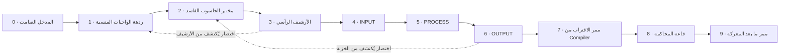

# M15 — خريطة جناح البرمجة المنسي

توضح الخريطة اتصال المناطق العشر ومساري العودة المختصرين. الأرقام `0–9` معرفات الغرف في بنية المرحلة؛ الأسماء المعروضة للاعب تبدأ بالمنطقة الأولى. الخطوط في المخطط تصف الاتصال المنطقي، ولا تمثل مقياسًا هندسيًا للمسافات أو الارتفاعات.

يشير اتجاه الأسهم الرئيسية إلى ترتيب التقدم. توجد مخارج للرجوع بين الغرف المتجاورة، ويصبح الاختصار صالحًا للعودة بين طرفيه بعد فتح شرطه. يتم العبور بالتفاعل قرب المخرج، لا بمجرد بلوغ طرف الشاشة.

| المعرف | المنطقة | وظيفة البيئة والتقدم |
|---|---|---|
| 0 | The Silent Entrance | بداية آمنة، استراحة، صعود تعليمي وجهاز وصول |
| 1 | Hall of Forgotten Assignments | اجتياز أفقي ومنصات قصيرة ومساحة أول مواجهة مستقبلية |
| 2 | Corrupted Computer Laboratory | طبقات من الممرات والطرفيات ومسارات علوية وسفلية |
| 3 | Vertical Archive | صعود ونزول فعليان، شرفات وعودة مختصرة إلى الغرفة 1 |
| 4 | INPUT Chamber | الخطوة الأولى من منظومة البرمجة |
| 5 | PROCESS Hall | الخطوة الثانية، بعد تفعيل INPUT |
| 6 | OUTPUT Vault | الخطوة الثالثة وفتح المسار التالي، واختصار إلى الغرفة 2 |
| 7 | Compiler’s Approach | استراحة آمنة منفصلة عن ساحة المواجهة المستقبلية وبوابة غرض الوصول |
| 8 | Lecture Tribunal | بيئة قاعة Dr. Compiler وفراغ القتال وردود فعل البيئة مستقبلًا |
| 9 | Aftermath Passage | ممر أهدأ يقود باتجاه المرحلة الثانية؛ يُفتح في التقدم العادي بعد الزعيم |

## لغز التقدم

تسلسل المنظومة هو **INPUT → PROCESS → OUTPUT**. لا تعادل زيارة الغرفة تفعيل مرحلتها؛ يعتمد الفتح على التفاعل بالترتيب الصحيح. تُستخدم استجابة الضوء والآلات والباب لتوضيح النتيجة، إلى جانب النص المساعد.

الاختصاران من `3 إلى 1` ومن `6 إلى 2` طريقا عودة يُكتشفان من الجهة المتقدمة. اجتازهما الاختبار في الاتجاهين بعد الفتح، دون منح اكتمال مواجهة لم تحدث.

## مراجعة البيئة مقابل التقدم العادي

| الحالة | ما تسمح به | ما لا تمنحه |
|---|---|---|
| جولة معاينة البيئة | زيارة الغرف خلف أقفال القتال المستقبلية لمراجعة الفن والتنقل | مفتاح الوصول، نتيجة مواجهة، هزيمة الزعيم أو انتصار |
| التقدم العادي | فتح اللغز والتفاعلات البيئية وفق شروطها | فتح بوابة قتال لمجرد عدم وجود أعداء منفذين بعد |
| ربط القتال لاحقًا | فتح بوابات المواجهات بعد نتائج قتال حقيقية، ثم الحصول على الغرض المطلوب | تسليم غرض الوصول تلقائيًا عند دخول الممر |

الأعداء ومعركة الزعيم مؤجلون إلى مرحلتهم. لذلك تظل أقفال القتال في التقدم العادي مغلقة حتى تستقبل نتيجة مواجهة حقيقية؛ وجود الجولة يتيح مراجعة بيئتهم دون تسجيل تقدم قتالي وهمي.

## التحقق وحدود الخريطة

هذه بنية الغرف المنفذة في M15. اجتاز اختبار Godot المتصل المسار التالي بإدخال الحركة والتفاعل، دون نقل موضع البطل أو حقن أعلام التقدم من الاختبار:

`0 → 1 → 2 → 3 → 1 → 3 → 4 → 5 → 6 → 2 → 6 → 7 → 8 → 9`

سُجلت 14 عملية عبور، تشمل عتبة نهاية الجولة بعد الغرفة 9؛ العتبة لا تحمل مرحلة ثانية منفذة. يشمل المسار الغرف العشر والاختصارين في الاتجاهين. عبور أقفال القتال في الجولة معلَّم صراحةً كمعاينة للبيئة، ولم يمنح مفتاحًا أو هزيمة زعيم.

الأدلة التفصيلية في [M15_ENVIRONMENT_QA.json](../M15_ENVIRONMENT_QA.json) و[تقرير الاختبار بالعربية](M15_TEST_REPORT_AR.md). صور الغرف ناتجة من تشغيل مرئي منفصل موثق في [M15_VISUAL_REVIEW.json](../M15_VISUAL_REVIEW.json)، وليست دليلًا مستقلًا على اجتياز المسار. المحرك المستخدم فعليًا هو Godot **4.6.3**؛ لم يُختبر Godot **4.7**.
