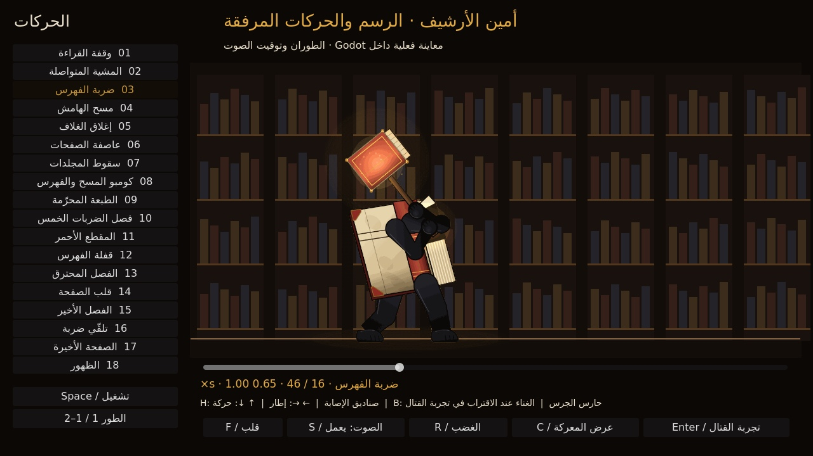
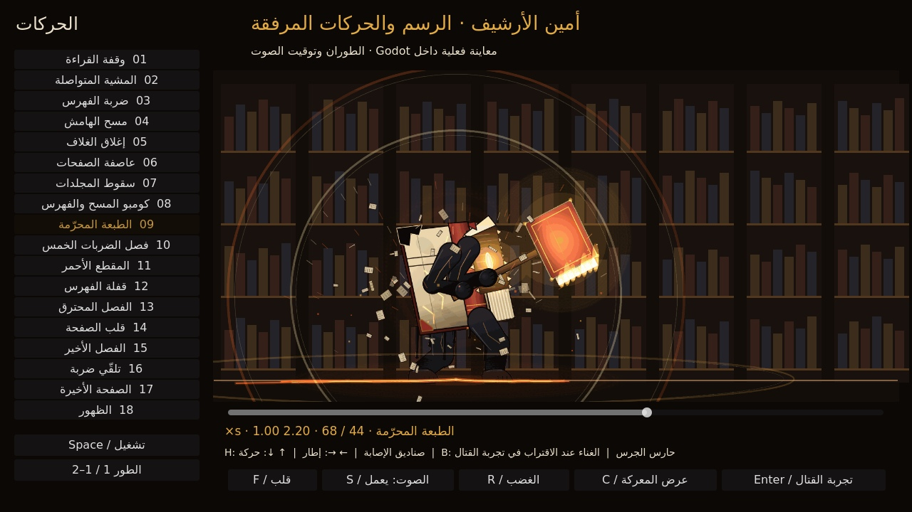
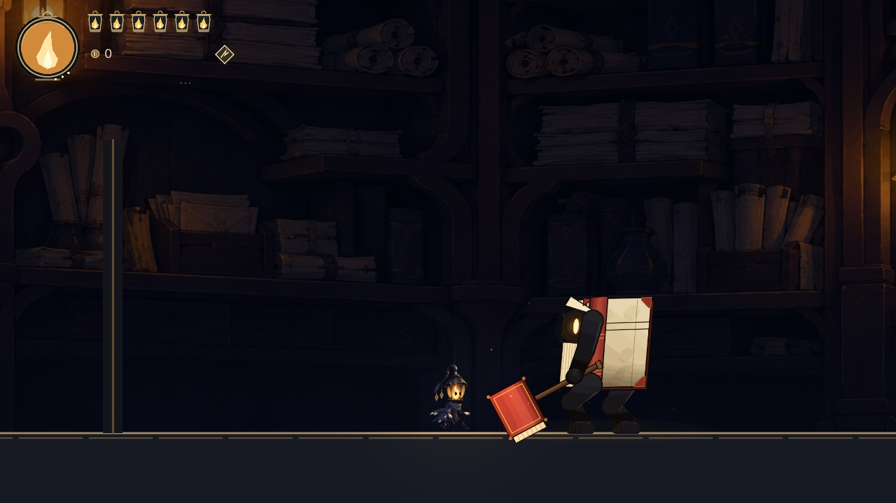
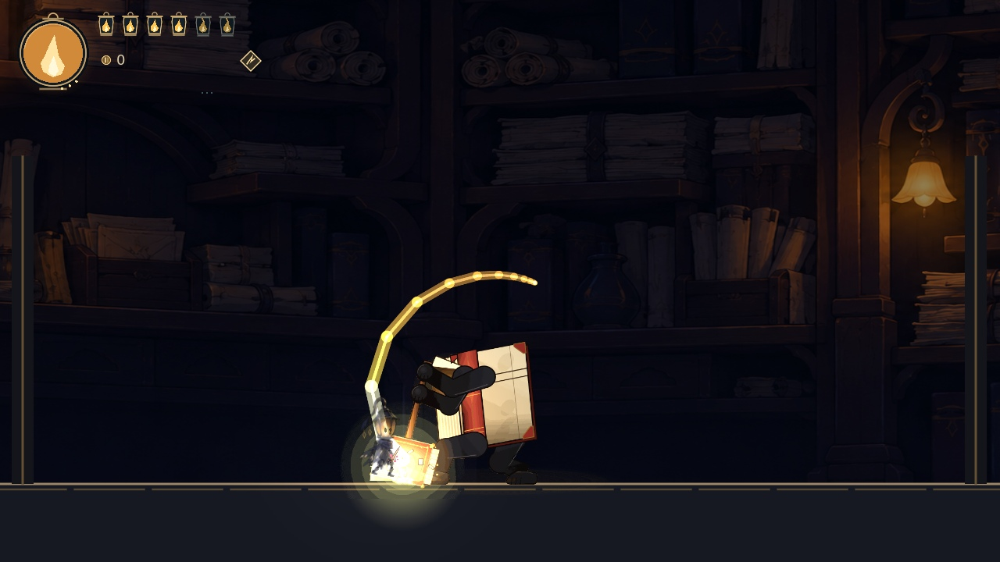

# أمين الأرشيف — معاينات الملفات المرفقة داخل Godot

تعرض هذه المعاينات الرسوم والحركات التي رفعها المستخدم، بعد نقلها إلى Godot دون إعادة رسم الشخصية. مصدر المؤثرات الصوتية هو الحزمة المرفقة. ويصدر تسجيل الغناء السابق من جسم العدو قبل المواجهة، مع تغيّر شدته واتجاهه وفق موضع البطل وتوقفه عند بدء القتال.

صور استوديو الحركات تسجيل لمعاينة مضبوطة يمكن فيها اختيار الحركة والإطار والطور. لا تُقدَّم هذه الصور كإثبات لقتال فعلي. أما تسجيل الاقتراب فيستخدم حركة البطل الفعلية في مشهد التجربة، دون تعديل صحته أو إجبار العدو على وضعية للكاميرا.

يُرفق مع الصور والفيديو ملف بيانات يحدد إصدار Godot، وأسماء الملفات وتجزئاتها وقت التسجيل، والحركة والإطار والطور، وحدود ما يثبته التسجيل. المعاينات الأولية أثناء العمل لا تعني اكتمال الاختبارات أو ثبات ملفات الإصدار النهائي.

## صور استوديو الحركات

| المعاينة | الصورة |
| --- | --- |
| المشي وحمل المطرقة بيد واحدة | [المشي](../previews/m26_imported/02_walk.jpg) |
| إصابة المطرقة بالأرض | [ضربة الفهرس](../previews/m26_imported/04_index_slam.jpg) |
| هيئة الطور الثاني | [الطبعة المحرّمة](../previews/m26_imported/06_phase_two.jpg) |
| جدران الصفحات بعد استكمال المؤثرات من مصدر الـHTML | [قفلة الفهرس](../previews/m26_imported/07_page_walls.jpg) |
| اندفاع الفصل الأخير | [الاندفاع](../previews/m26_imported/08_final_chapter.jpg) |
| قلب الشخصية حول نقطة القدم نفسها | [المشي يسارًا](../previews/m26_imported/09_walk_left.jpg) |

[بيانات تسجيل الصور وتجزئات مصادرها](../previews/m26_imported/catalog_still_metadata.json)

## الفيديو

- [استوديو الحركات كاملًا — 42.37 ثانية](../previews/m26_imported/10_native_animation_catalog.mp4): الحركات الثماني عشرة، والتحول، وهجمات الطورين، مع المؤثرات الصوتية المرفقة. هذه معاينة حركات مضبوطة.
- [الاقتراب من الغناء وبدء المواجهة — 15.67 ثانية](../previews/m26_imported/30_native_singing_approach.mp4): حركة فعلية للبطل، وقطع الغناء عند بدء القتال، ثم إيقاف مؤقت واستئناف وابتعاد وعودة دون رجوع الغناء. يقف البطل لاحقًا لتظهر هجمات العدو وضررها الطبيعي؛ ليست هذه محاولة لاستعراض مهارة اللاعب أو هزيمة الزعيم.

[بيانات فيديو الاستوديو](../previews/m26_imported/catalog_movie_metadata.json) · [بيانات تسجيل الاقتراب](../previews/m26_imported/approach_capture_metadata.json) · [فحص ملفات الفيديو والصوت](../previews/m26_imported/media_validation.json)

سُجل الفيديوان من مشاهد المشروع داخل Godot 4.7.2 بدقة 1280×720، ثم حُوّلا إلى H.264/AAC مع الاحتفاظ بصوت Godot نفسه. لم تُضف موسيقى بديلة أو أصوات بطل أو رسومات فوق التسجيل. يثبت معدل التسجيل 60 إطارًا في الثانية التوقيت المستخدم للتصدير، ولا يمثل قياس أداء جهاز اللاعب.
