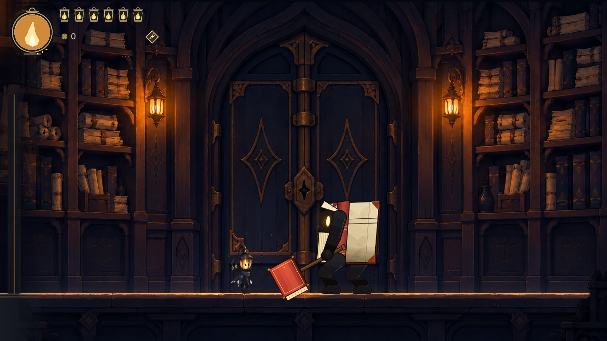
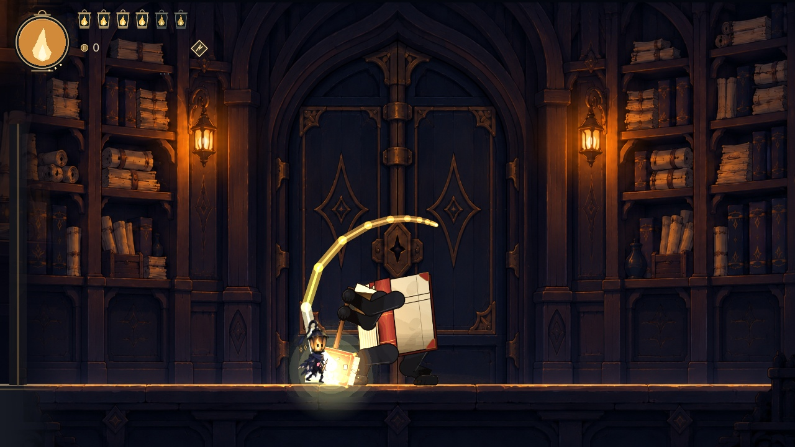
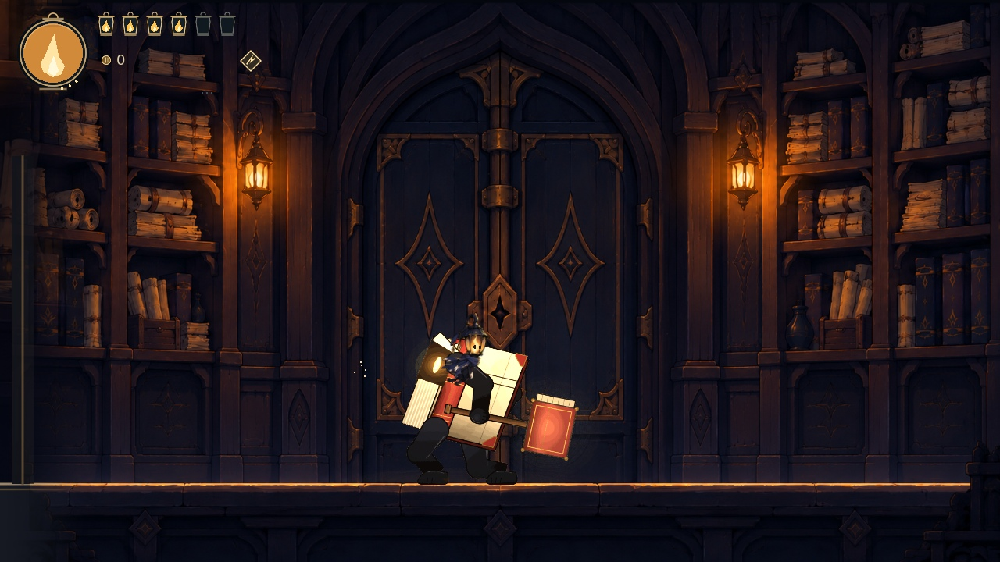
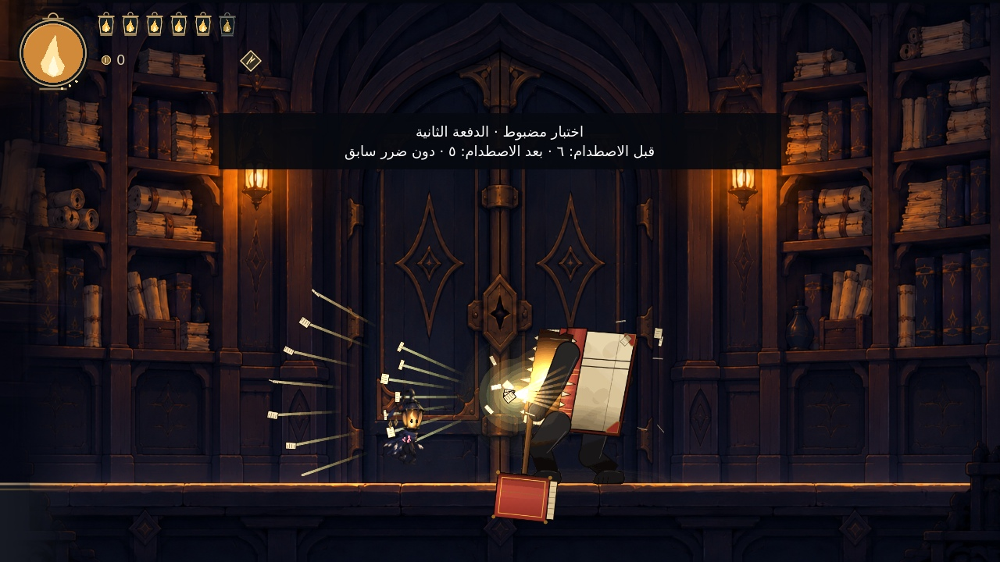
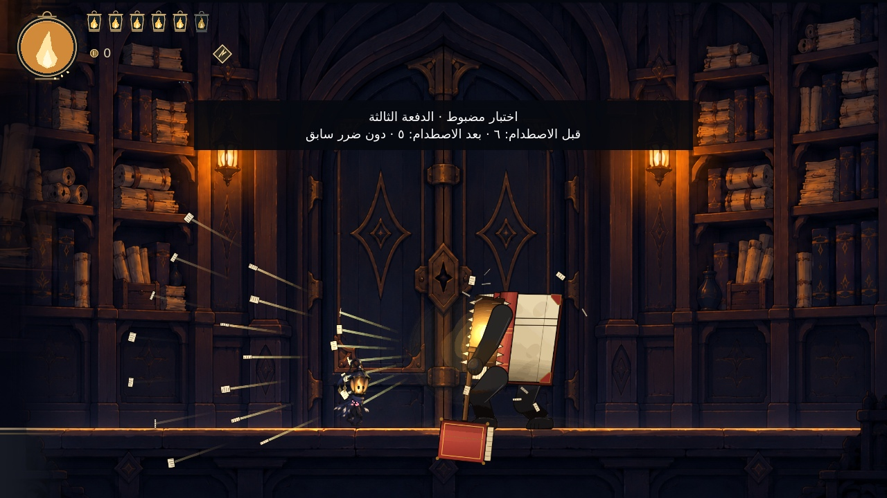

# أمين الأرشيف — معاينات M27

معاينات أصلية داخل Godot للمواجهة في قاعته الخاصة، مع البطل نفسه وواجهة الصحة والطاقة. يستخدم تسجيل الحركة أزرار اللعب العادية، دون تعديل صحة البطل أو اختيار هجمة للعدو أو فرض وضعية عليه لأجل التصوير.

تُسجل مع كل عينة حالة المواجهة ومواقع الشخصيتين والضربة ومدى بدايتها وبصمات ملفات الرسم والصوت والمشهد وقت الالتقاط. المعاينة المبكرة للقاعة لا تعني انتهاء فحوص السلوك القتالي.

[بيانات عينة القاعة](../previews/m27/arena_sample_metadata.json)

## فيديو الحركة والمواجهة

[مشاهدة التسجيل الأصلي — 10.62 ثانية](../previews/m27/10_actual_melee_and_movement.mp4)

يبدأ التسجيل بالغناء من جهة العدو، ثم يقترب البطل ويتوقف الغناء عند بدء المواجهة. يمشي أمين الأرشيف حتى يبلغ مدى ضربته، فتصل الضربة الثقيلة الأولى إلى البطل. بعدها يبتعد البطل، فيقترب العدو مجددًا، ثم يتفادى البطل الضربة التالية بقفز وداش عاديين. صحته طبيعية: تبدأ بستة فوانيس، وتنخفض إلى أربعة بعد الضربة الأولى، وتبقى أربعة بعد التفادي.

كانت مسافة بدء الضربة الأولى 143.83 بكسل، داخل مداها المعتمد حتى 145 بكسل. يثبت التسجيل وصول أول هجمة قريبة، دون تعديل صحة البطل أو اختيار هجمة للعدو أو فرض وضعية عليه. تنفذ الإصابة الأولى الموجة المرئية المصاحبة لضربة المطرقة.

| المراجعة | الصورة |
| --- | --- |
| المشي حتى بلوغ المدى | [الاقتراب](../previews/m27/02_walk_into_range.jpg) |
| رفع المطرقة من المسافة القريبة | [الاستعداد](../previews/m27/03_staff_ready_in_range.jpg) |
| الاقتراب مجددًا بعد تراجع البطل | [المطاردة](../previews/m27/05_reapproach_after_retreat.jpg) |

[بيانات تسجيل الأزرار والحالات وبصمات المصادر](../previews/m27/actual_input_capture_metadata.json) · [فحص الفيديو والصوت](../previews/m27/media_validation.json)

## فحص الدفعتين الثانية والثالثة من الورق

صورتا اختبار اصطدام مضبوطتان: يُثبَّت توقيت الحركة وموضع البطل على ورقة من الدفعة المحددة، مع صحة بداية ستة فوانيس ودون ملامسة ورقة من الدفعات السابقة في الموضع المختبر. ينفذ منطق الإصابة نفسه ضررًا واحدًا، فتصبح الصحة خمسة فوانيس في كل حالة. توضح الكتابة داخل الصورتين طبيعة الفحص.

[بيانات فحص الورق](../previews/m27/paper_fixture_metadata.json)

التسجيل من Godot 4.7.2 بدقة 1280×720، مع صوت اللعبة الأصلي، ثم تحويله إلى H.264/AAC. معدل التصدير 60 إطارًا في الثانية يحدد توقيت التسجيل ولا يمثل اختبار أداء جهاز اللاعب.
