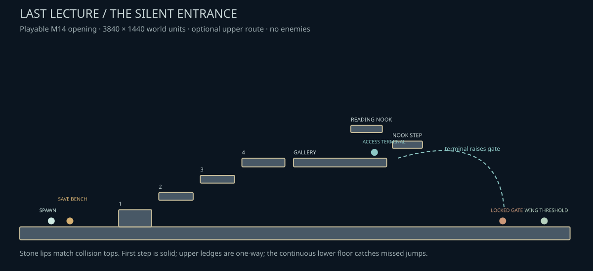
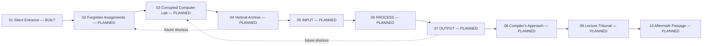

# Stage 01 — The Forgotten Programming Wing

**Built and playable in M14:** The Silent Entrance, its upper gallery, optional reading nook, checkpoint, terminal and gate. All other named areas below are planned, not playable additions in this release.

The upper route restores the gate on the safe lower floor. The reading nook is optional. All solid ledges and the door exist as separate nodes in the Godot scene.

Enemy-clearance gates and the boss-access item belong to later work. The new opening contains no enemy instances; enemy references are used only for visual coherence and future space planning.
